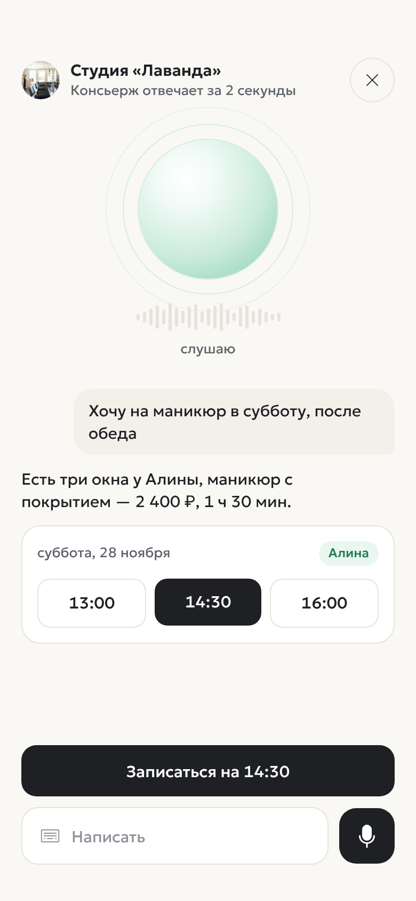
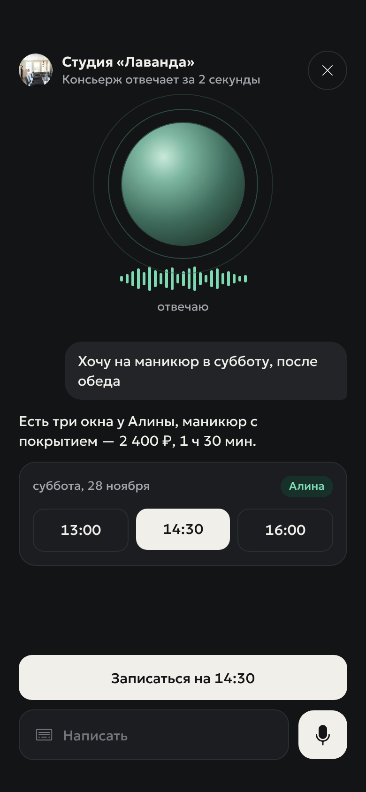
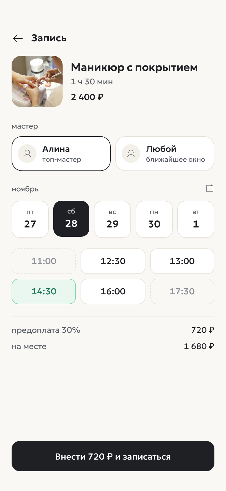
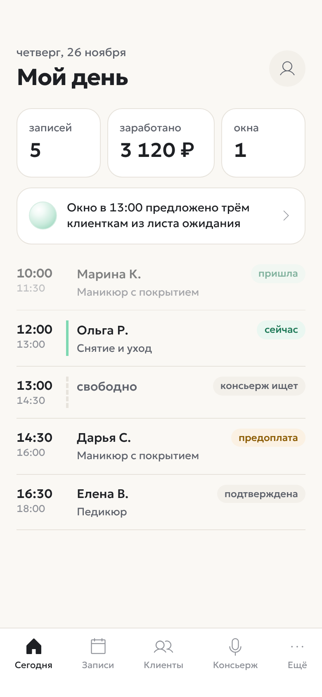
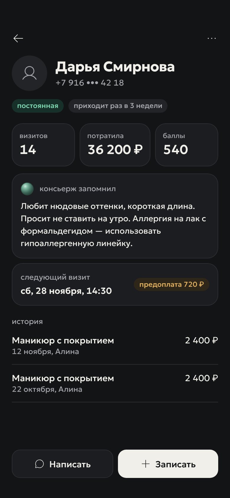
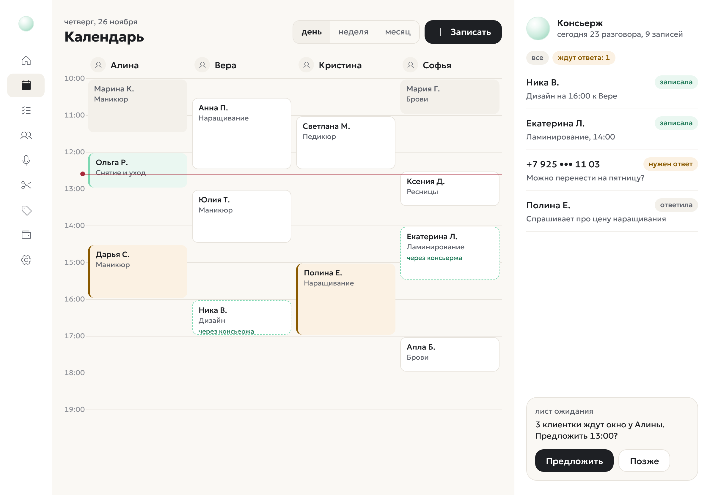
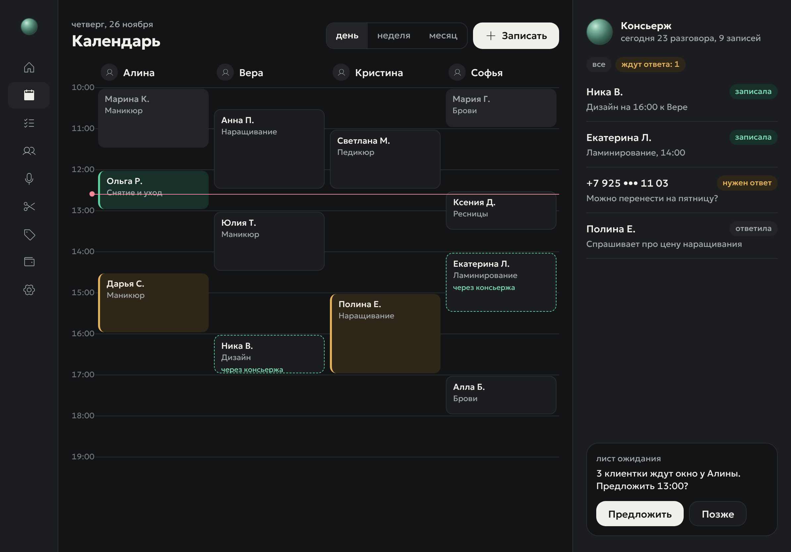
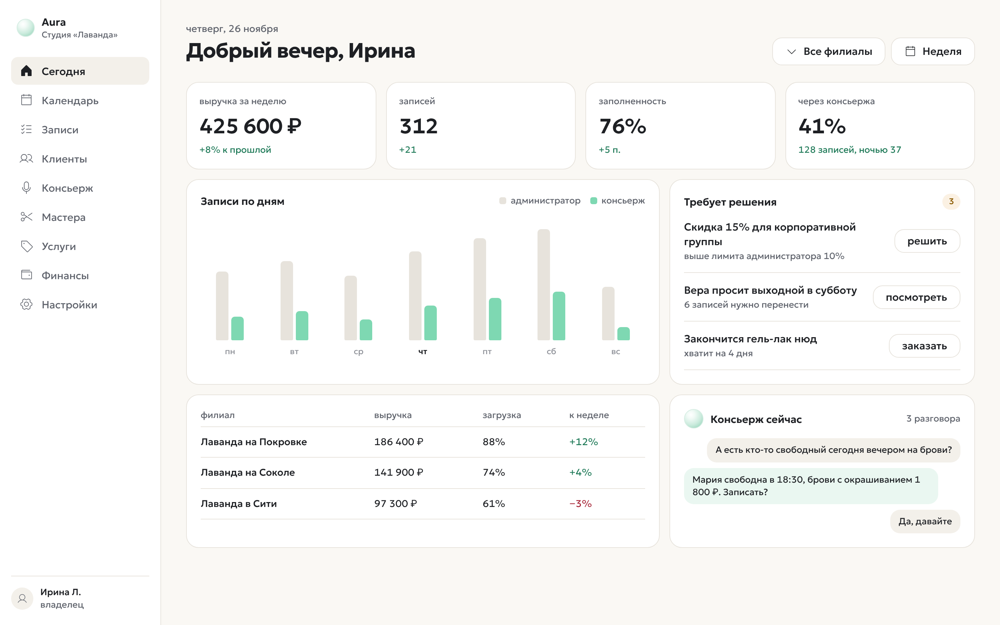
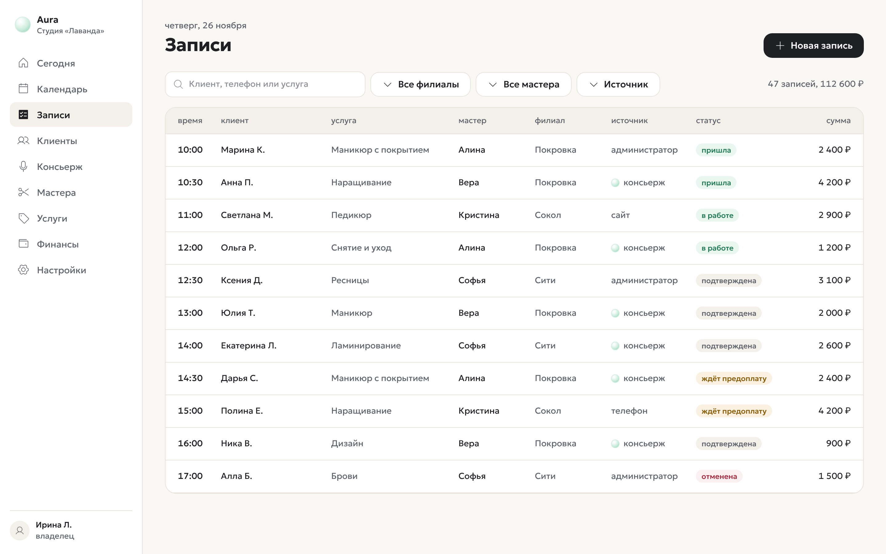
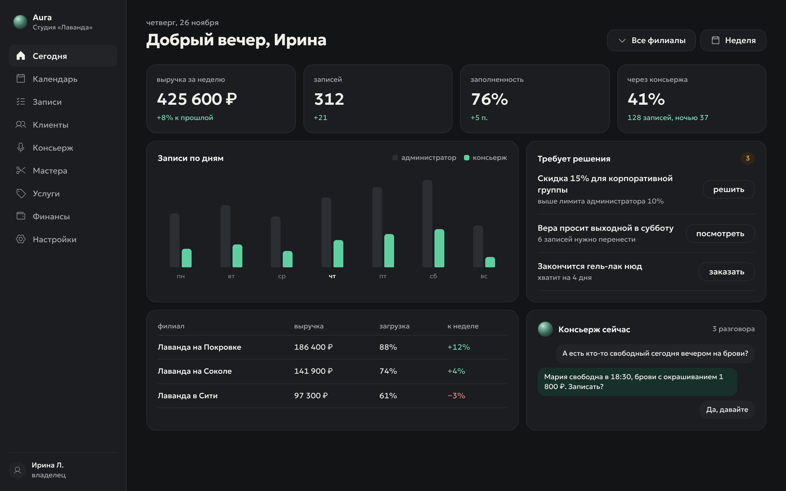

# AURA OS — направление A «Тихая мята»

Дизайн-комплект для фронтенда AURA OS (backoffice и публичные страницы). Папки: `html/` — вёрстка экранов, `screens/` — PNG @2x, `photos/` — фото, `fonts/` — шрифт.
Бэкенд, API, схема БД и права не меняются: комплект описывает только внешний вид.

## Токены
Две темы с одними и теми же ролями. Тема переключается целиком: в вёрстке все цвета заданы через переменные.

| Роль | Светлая | Тёмная |
|---|---|---|
| Фон страницы `--bg` | #FAF8F4 | #131416 |
| Карточки, панели `--surf` | #FFFFFF | #1B1D20 |
| Вторичная заливка `--sub` | #F3F0EA | #222428 |
| Линии `--line` | #E7E3DC | #2B2E33 |
| Текст `--ink` | #1E2024 | #F1EFEA |
| Вторичный текст `--mut` | #5F636C | #A3A6AB |
| Подсказки `--faint` | #8E9198 | #74777D |
| Кнопка `--btn` / текст на ней | #1E2024 / #FFFFFF | #F1EFEA / #131416 |
| Мята (график, «сейчас», консьерж) `--mint` | #7ED8B2 | #5FCFA0 |
| Мятный текст / фон `--minttx` / `--mintsoft` | #1F7A58 / #EAF7F1 | #7ED8B2 / #17302A |
| Ожидание (предоплата, перенос) | #8A5A00 на #FBF1E3 | #E3B25E на #2E2618 |
| Отмена, деньги под вопросом | #A8283A на #FBF0F1 | #F08A96 на #33191D |

Шрифт: **Geologica** 400/500/600/700 (из `fonts/`, без внешних CDN). Цифры моноширинные (`tabular-nums`). Заголовки 24–30px/700, межбуквенный −0.02em; текст 14–15px.
Скругления: карточки 18px, кнопки и поля 12–14px, статусы — пилюли. Основная кнопка тёмная (в тёмной теме — светлая), мята — акцент, а не заливка кнопок.

## Сфера консьержа
Матовый перламутровый шар без свечения: радиальная заливка самого шара (блик слева сверху, мята к краю) и линия 1px. Не фиолетовый, без размытого ореола и без пятен на фоне.
- Большая (132px) — только на экране голосового консьержа, с двумя тонкими кольцами и строкой-волной. Состояния: «слушаю» (волна серая), «отвечаю» (волна мятная), «думаю» (кольца медленно пульсируют, 1.6 с, ease-in-out; при prefers-reduced-motion — без анимации).
- Малая (14–40px) — метка «это сделал консьерж»: в ленте, у записей с источником «консьерж», в карточке клиента («консьерж запомнил»), в логотипе.
- Заменяет текущий `AuraOrb` из `lib/ui` (пятна mint/turquoise/lilac + блик).

## Общие правила (как для Триады, Resto AI и Owner OS)
- Источник истины — файлы в `html/`; `screens/` — эталон для сверки.
- Иконки — Phosphor Icons, вес Light; активный пункт меню — Fill. Lucide заменить.
- Запрещено: градиентные фоны страницы с пятнами, стекло, светящийся шар ИИ, ярко-синий как основной, подписи ЗАГЛАВНЫМИ с разрядкой (сейчас «РАБОЧЕЕ ПРОСТРАНСТВО», «СЕССИЯ» и т. п. — перевести в строчные), буквы вместо иконок, одинаковые карточки с мягкой тенью, эмодзи, разделители «A · B · C».
- Карточки: линия 1px без тени. Плотные списки — строки с линией, а не карточки.
- Фото — только интерьеры и руки из `photos/`; людей со стоков не ставить.
- Название студии «Лаванда», имена и цифры — демонстрационные; в приложении использовать данные арендатора и термины Industry Pack.

## Навигация
Длинное меню из ~22 пунктов сгруппировать: основные — Сегодня, Календарь, Записи, Клиенты, Консьерж, Мастера, Услуги, Финансы; остальное (предоплата, оплаты, зарплаты, лояльность, импорт, база знаний, виджет, отрасль, права, состояние API) — во вложенных разделах «Финансы» и «Настройки». Видимость по-прежнему по правам роли (`can()`), подписи — через термины отрасли.
Планшет: узкая колонка иконок 88px. Телефон: нижняя панель из 5 пунктов.

## Экраны
Номера: 01–19 телефон 390px, 20–29 планшет 1194×834, 30+ компьютер 1440px.

| Файл | Размер | Тема | Что это | Маршрут в приложении |
|---|---|---|---|---|
| `01-konsyerzh-svetlaya` | 390×844 | светлая | голосовой консьерж для клиента, «слушаю» | `/c/:companySlug` |
| `02-konsyerzh-tyomnaya` | 390×844 | тёмная | тот же экран, «отвечаю» | `/c/:companySlug` |
| `03-zapis` | 390×844 | светлая | выбор мастера, дня, времени, предоплата | `/b/:token`, шаг записи |
| `04-den-mastera` | 390×844 | светлая | день мастера, окна, подсказка консьержа | `/calendar` (роль мастера), `/my-earnings` |
| `05-klient` | 390×844 | тёмная | карточка клиента, заметки консьержа | `/clients/:id` |
| `20-kalendar-svetlaya` | 1194×834 | светлая | календарь администратора + лента консьержа | `/calendar` |
| `21-kalendar-tyomnaya` | 1194×834 | тёмная | то же | `/calendar` |
| `30-svodka-vladeltsa-svetlaya` | 1440×900 | светлая | сводка владельца | новый стартовый экран после входа |
| `31-zapisi` | 1440×900 | светлая | таблица записей с фильтрами | `/bookings` |
| `32-svodka-vladeltsa-tyomnaya` | 1440×900 | тёмная | сводка владельца | то же |

Остальные разделы перевести на те же токены и компоненты (шапка страницы, карточка, таблица-строки, пилюли статусов, кнопки) без отдельных макетов.

| | |
|---|---|
|  |  |
|  |  |
|  |  |
|  |  |
|  |  |
