# Loop Card AI — умная карта лояльности в Apple Wallet и Google Wallet с AI-маркетологом

Дизайн-комплект для реализации. Папки: `html/` — вёрстка экранов, `screens/` — PNG @2x, `photos/` — фото, `fonts/` — шрифт.
Направление «Чернила и латунь»: тёмно-синяя карта с латунным акцентом, интерфейсы гостя и владельца светлые.
Пилот: салоны Extendess (YCLIENTS) и ресторан «Ботаника» (R-Keeper), владелец Алексей Борисович.

## Токены
| Роль | Цвет |
|---|---|
| Текст | #16201B |
| Вторичный текст | #5F6B63 |
| Линии | #E5E2DA |
| Фон | #FFFFFF / #F5F3EE |
| Бренд: карта, основные кнопки, меню ПК | #172231 (чернила), второй тон #212E40, линии на тёмном #314156 |
| Текст на тёмном | #EDE6D6, вторичный #A6B0BE |
| Акцент: уровень, AI, прогресс | #C7A46A (латунь), текстом на светлом #8A6A2F |
| Деньги, рост | #1E7A4C (на тёмном #8FD0A8) |
| Риск, «уходящие» | #B5402A |
| Затемнение фото | rgba(14,22,34,0.28–0.58), без градиентов |

Шрифт: **Manrope** 400/500/600/700. Знак Loop — два сцепленных кольца, линия 1.8px, латунь.

## Экраны
Номера: 00–19 телефон 390×844, 30+ компьютер 1440×900.

**Гость**
| Файл | Что |
|---|---|
| `00-nomer-i-sms-kod` | после QR: телефон и код из SMS (без кода карту не выдаём) |
| `01-qr-dannye-podstavleny` | данные найдены в YCLIENTS/R-Keeper и подставлены; две галочки согласий; Apple/Google Wallet |
| `02-qr-karta-v-koshelke` | системное окно «Добавить» с готовой картой |
| `03-salon-licevaya`, `04-salon-oborot` | Extendess в Apple Wallet: баллы, уровень, следующий визит, мастер / оборот со ссылкой «Спросить AI» |
| `05-restoran-licevaya`, `06-restoran-oborot` | «Ботаника» в Google Wallet: баллы, уровень, бронь, стол / подробности |
| `07-ekran-blokirovki` | три уведомления: гео у ресторана, свободное окно у мастера, повтор процедуры |
| `08-chat-ai` | веб-чат `loop.cards/<бизнес>` — открывается отдельной страницей |
| `09-golosovaya-zapis` | голосом «запиши меня к Ольге на завтра» → слот → запись |

**Кабинет, телефон** — меню: Акции · Маркетолог · Клиенты · Результаты · Программа
| Файл | Что |
|---|---|
| `10-kabinet-predlozheniya` | «Акции»: предложения AI для групп, кнопка «Одобрить» |
| `11-kabinet-klienty` | группы: уходящие, пора на визит, постоянные, новые |
| `12-kabinet-rezultaty` | результат в рублях за месяц, разбивка по действиям |
| `13-kabinet-programma` | уровни, баллы, что AI делает без одобрения, лимиты |
| `14-marketolog-lenta` | AI-маркетолог: персональные предложения по одному (фото, что, почему, как увидит клиент) |
| `15-klient-kartochka` | карточка клиента: траты, ритм, мастер, предложение AI, история предложений |

**Кабинет, ПК** — `30-pk-predlozheniya-i-rezultaty`, `31-pk-klienty`, `32-pk-programma`, `33-pk-ai-marketolog` (очередь · карточка · история).

## Механика и правила работы
- **Вход гостя:** QR → номер → SMS-код → данные из YCLIENTS/R-Keeper → согласия (152-ФЗ и рекламные сообщения, хранить факт и время согласия) → pkpass / Google Wallet save link.
- **Начисление и списание:** «Ботаника» — внешняя программа лояльности R-Keeper, кассир сканирует QR карты, баллы по чеку. Extendess — при закрытии визита в YCLIENTS. После каждой операции карта обновляется.
- **Уведомления:** через обновление карты (Apple: поле с changeMessage + APNs; Google: messages API). Коротко, не чаще 2 в неделю, не с 21:00 до 10:00. Длинное или если карты нет — SMS (позже Telegram).
- **Гео:** точки заведений прописаны в карте (до 10), карту на экране блокировки показывает сам кошелёк. Координаты гостя мы не получаем — в презентации писать «карта появляется, когда клиент рядом».
- **AI-маркетолог:** каждый день готовит персональные предложения (свободное окно, вернуть, повтор, день рождения, рядом, второй визит) и акции для групп. Без одобрения уходят только включённые в «Программе» действия. Устал от уведомлений (2 не открыл) → пауза 30 дней.
- **Как считаем «AI принёс»:** визит/чек в течение 14 дней после предложения минус скидка. 10% клиентов в контрольной группе без предложений — разница с ними и есть эффект.
- **Лимит скидок** в месяц на бизнес, скидка больше 15% — только с одобрением.
- **Чат:** веб-страница, не внутри карты (в карте только поля и ссылки). Голос — Web Speech API.

## Общие правила (как в resto/, owner/, triada/, aura/)
- Источник истины — `html/`; `screens/` — эталон для сверки. Фото — только из `photos/`, шрифт — из `fonts/`. Иконки — Phosphor Light, активный пункт меню — Fill.
- Запрещено: градиентные фоны с пятнами, стекло, светящийся шар AI, ярко-синий как основной цвет, ЗАГЛАВНЫЕ подписи, буквы вместо иконок, одинаковые карточки с мягкой тенью, эмодзи.
- Карточки — линия 1px, скругления 12–24px, цифры tabular-nums, подписи с маленькой буквы.
- Тёмный цвет только на карте, главной сумме, основной кнопке и меню ПК. Системные экраны Wallet и iOS не перерисовывать — настраивается только сама карта.
- Все цифры и имена клиентов демонстрационные.

| Экран | |
|---|---|
| `00-nomer-i-sms-kod` | 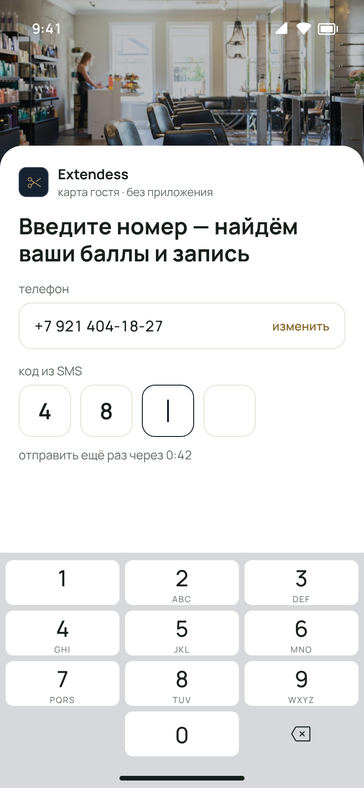 |
| `01-qr-dannye-podstavleny` | 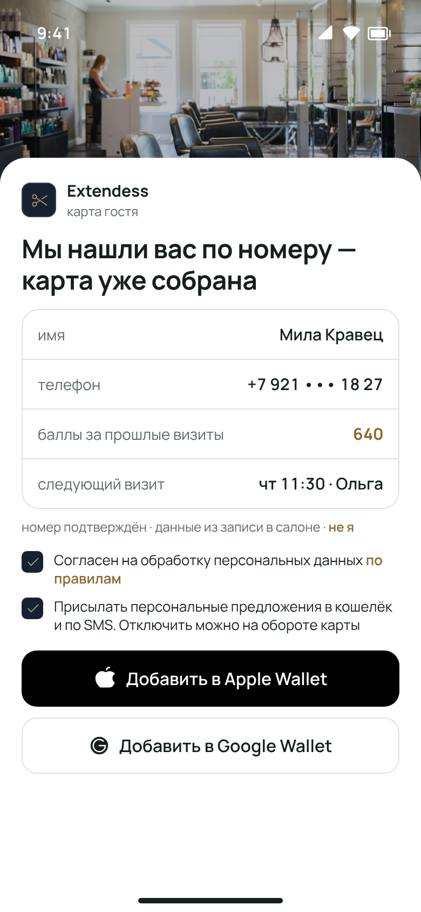 |
| `02-qr-karta-v-koshelke` | 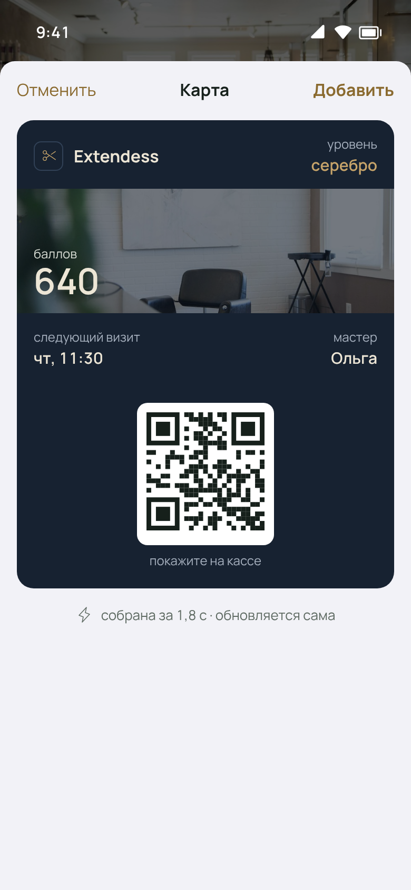 |
| `03-salon-licevaya` | 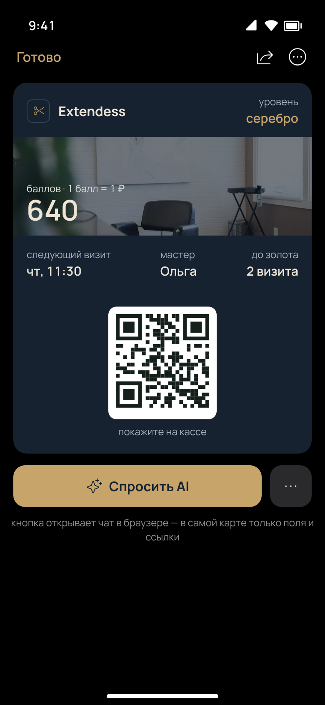 |
| `04-salon-oborot` | 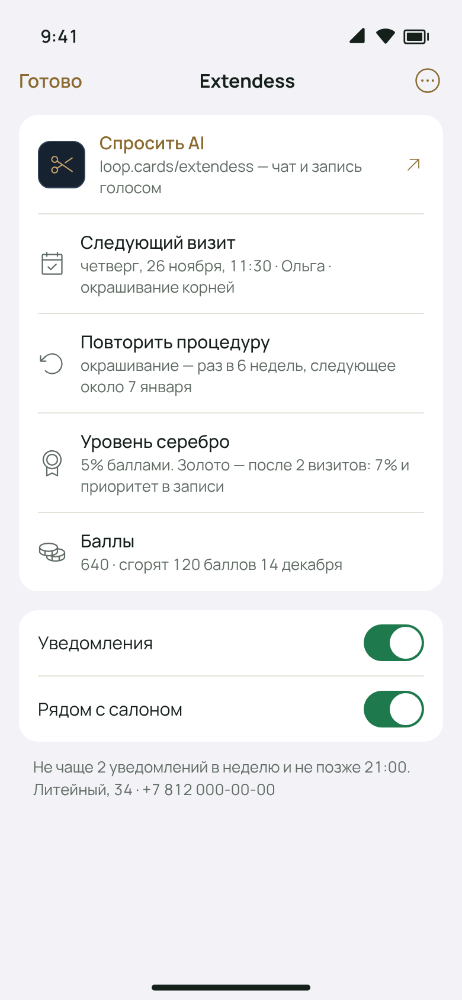 |
| `05-restoran-licevaya` | 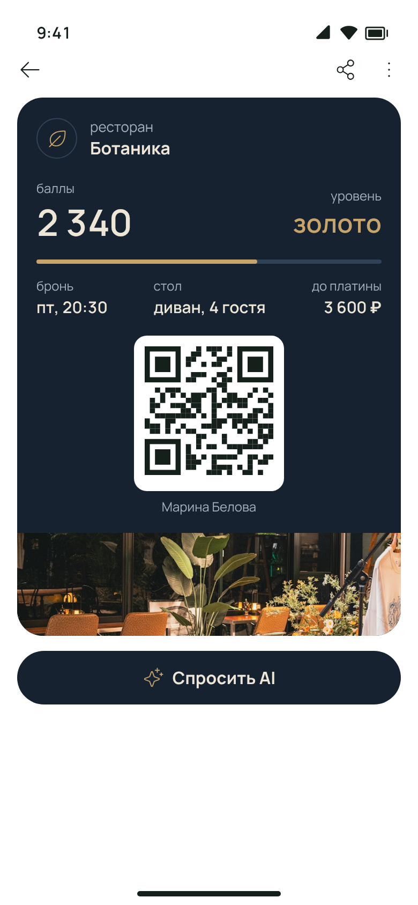 |
| `06-restoran-oborot` | 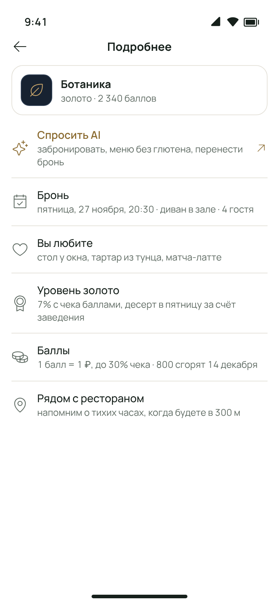 |
| `07-ekran-blokirovki` | 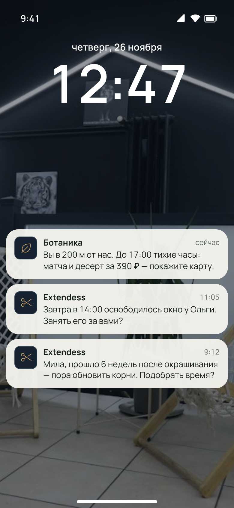 |
| `08-chat-ai` | 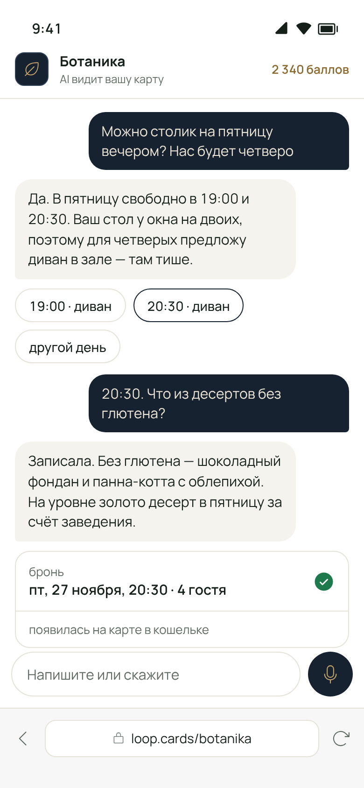 |
| `09-golosovaya-zapis` | 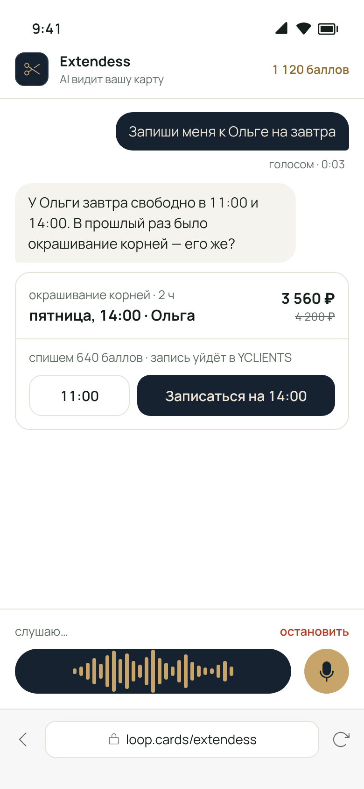 |
| `10-kabinet-predlozheniya` | 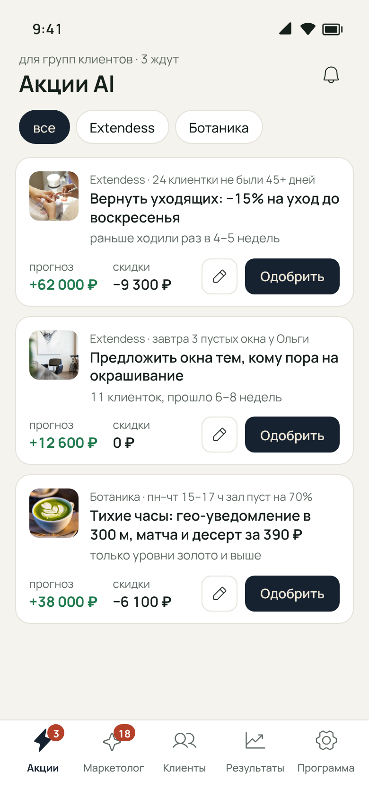 |
| `11-kabinet-klienty` | 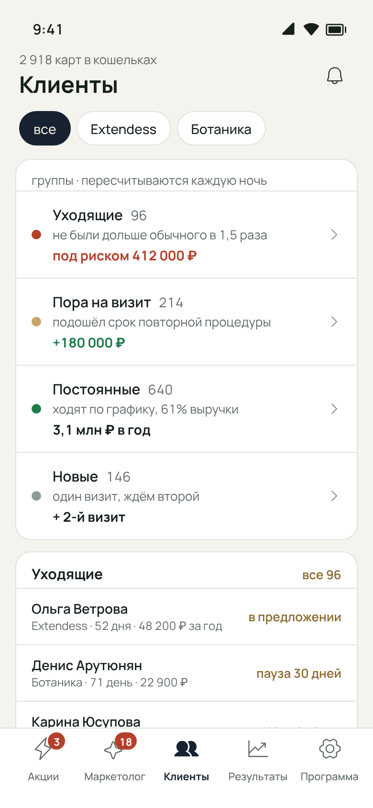 |
| `12-kabinet-rezultaty` | 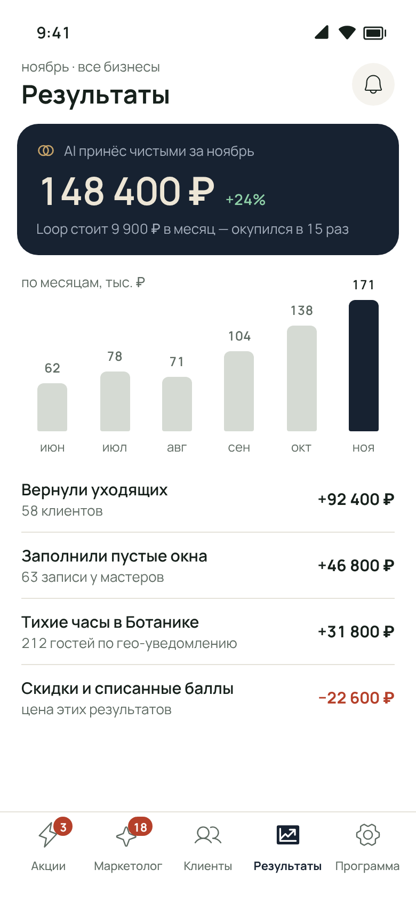 |
| `13-kabinet-programma` | 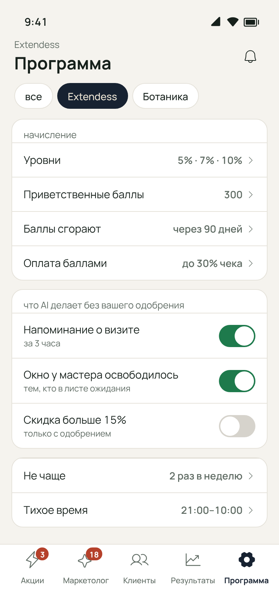 |
| `14-marketolog-lenta` | 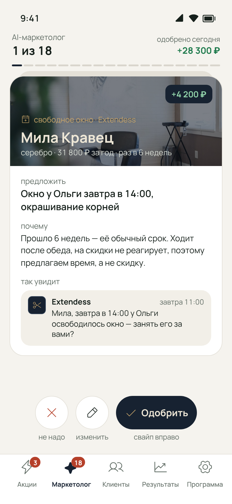 |
| `15-klient-kartochka` | 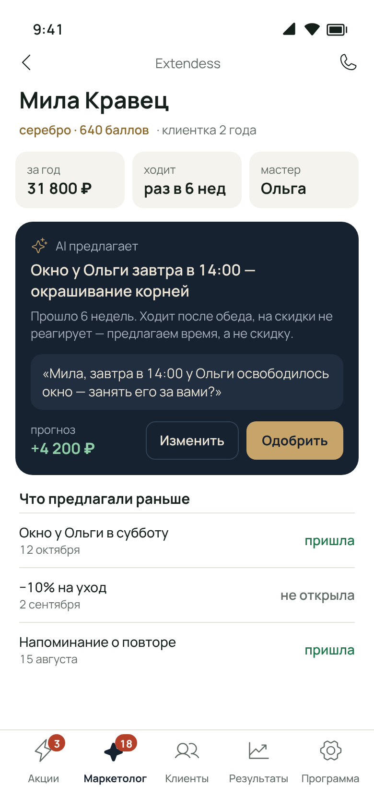 |
| `30-pk-predlozheniya-i-rezultaty` | 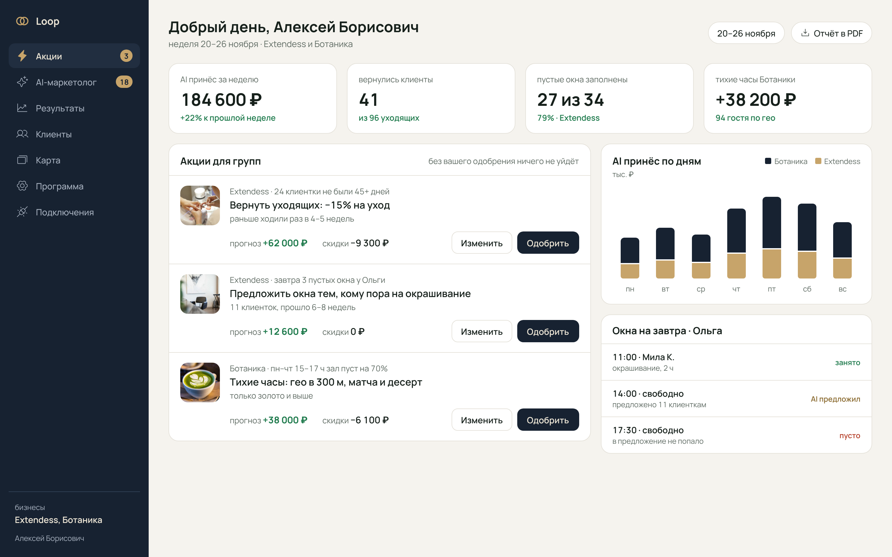 |
| `31-pk-klienty` | 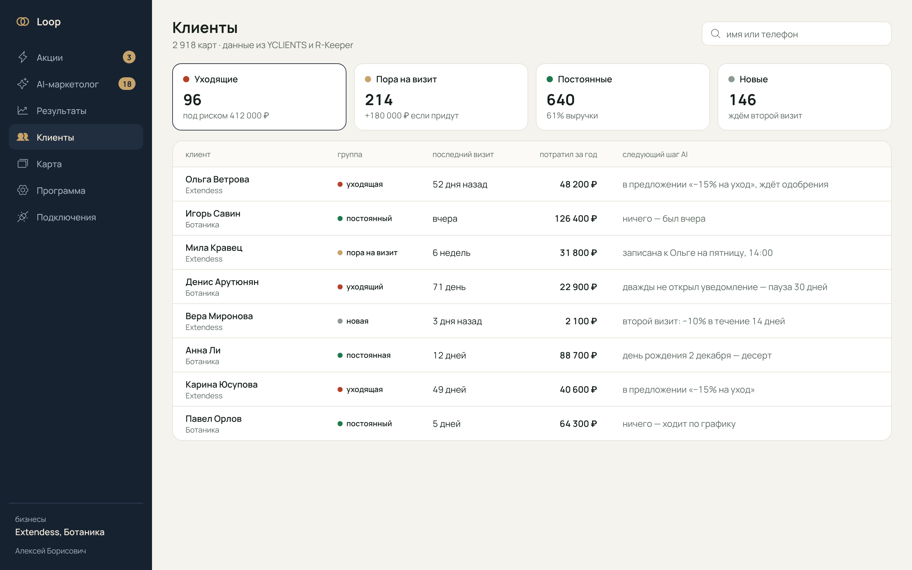 |
| `32-pk-programma` | 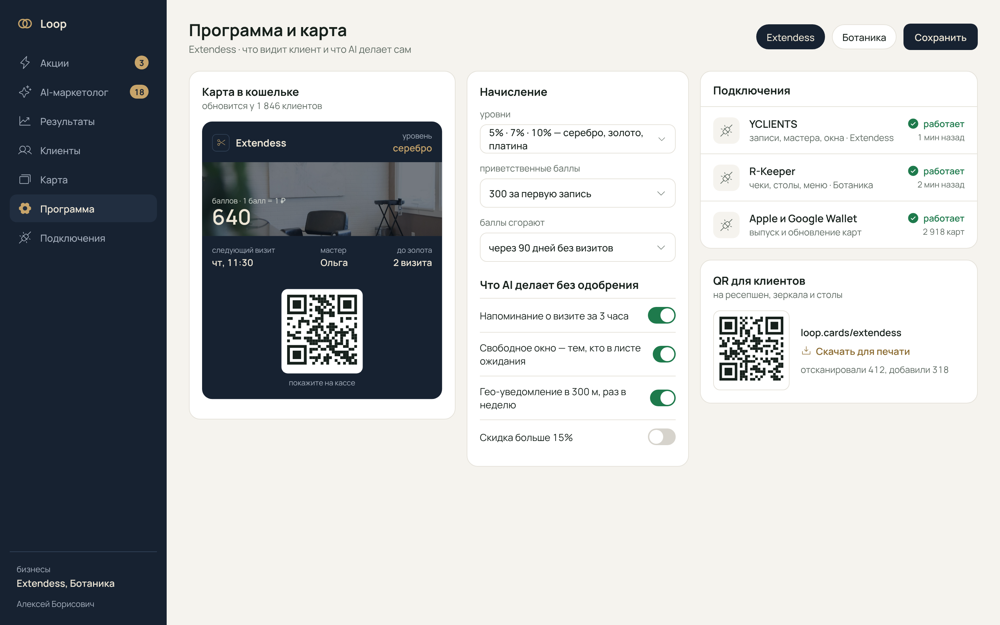 |
| `33-pk-ai-marketolog` | 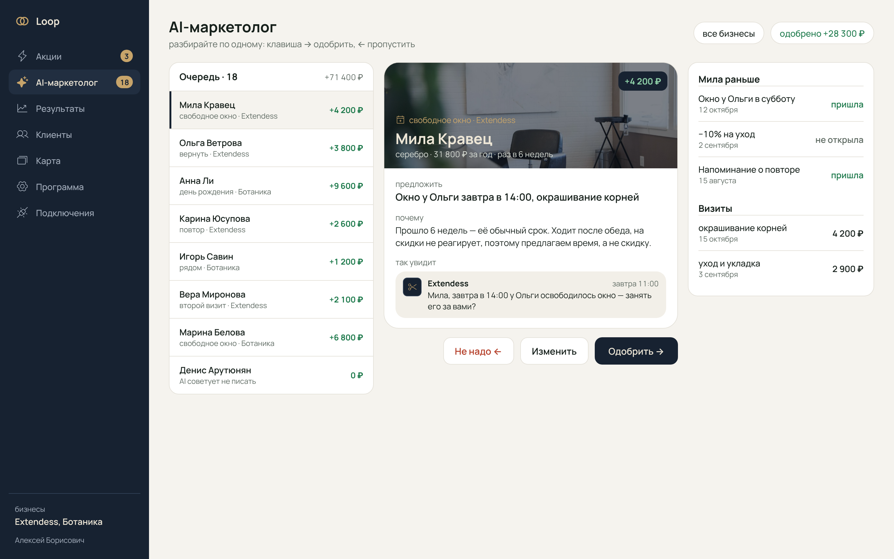 |
