# Loop Card AI — умная карта лояльности в Apple Wallet и Google Wallet с AI-маркетологом

Дизайн-комплект для реализации. Папки: `html/` — вёрстка экранов, `screens/` — PNG @2x, `photos/` — фото, `fonts/` — шрифт.
Направление «Лес и латунь»: тёмная карта с уровнями и латунным акцентом, интерфейсы для гостя и владельца светлые.

## Токены
| Роль | Цвет |
|---|---|
| Текст | #16201B |
| Вторичный текст | #5F6B63 |
| Линии | #E5E2DA |
| Фон | #FFFFFF / #F5F3EE |
| Бренд: карта, кнопки, меню ПК | #14261D (лес), второй тон #1E3529, линии на тёмном #2C4236 |
| Текст на тёмном | #EDE6D6, вторичный #A9B3A8 |
| Акцент: уровень, AI, прогресс | #C7A46A (латунь), на светлом фоне текстом #8A6A2F |
| Деньги, рост | #1E7A4C |
| Риск, «уходит», «нет связи» | #B5402A |

Шрифт: **Manrope** 400/500/600/700. Знак Loop — два сцепленных кольца (в `html/`, функция-аналог `mark`), линия 1.8px, цвет латунь.

## Механика
**Гость.** Сканирует QR на столе, кассе или зеркале → веб-страница (05) → «Добавить в Apple/Google Wallet», приложения нет. Карта (01, 02): уровень, баланс, прогресс до следующего уровня, QR для кассы. На обороте (04) первая строка — «Спросить AI» со ссылкой `loop.cards/<бизнес>`. Она открывает веб-чат (06) или App Clip с микрофоном (07). AI видит карту, траты и любимый стол или мастера, предлагает слоты, записывает в YCLIENTS или бронирует через R-Keeper, после записи визит появляется на карте (08). Пуши приходят через обновление карты (03): геопуш рядом с заведением, «пора на визит», пустые окна. Не чаще 2 раз в неделю и не после 21:00.

**Владелец.** Главная цифра везде — «AI вернул, ₽» (10, 30). AI готовит предложения: кого вернуть, какое окно заполнить, прогноз выручки и стоимость скидки. Владелец только одобряет или меняет (11, очередь в 30). Без одобрения AI делает только то, что включено в «Правилах для AI» (32): напоминания, ответы в чате. Отчёт за месяц в рублях с разбивкой по типам действий и строкой «итого чистыми» (12). Гости с сегментом и «следующим шагом AI» (31). Подключения R-Keeper / YCLIENTS / Wallet со статусом и состоянием «нет связи» (32). Бизнесы переключаются чипами: все / Сад / Норд.

**Интеграции пилота.** Салоны → YCLIENTS (записи, мастера, окна). Ресторан → R-Keeper (чеки, столы, меню). Карты → Apple Wallet PassKit (pkpass + push-обновления) и Google Wallet API (Loyalty class/object).

## Общие правила (как в resto/, owner/, triada/, aura/)
- Источник истины — файлы в `html/` (размеры, отступы, цвета, тексты). `screens/` (PNG @2x) — эталон для сверки.
- Фото — только из `photos/`. Шрифт — из `fonts/` (или Google Fonts). Иконки — Phosphor Icons, вес Light; активный пункт меню — Fill.
- Запрещено (признаки «сделано нейросетью»): тёмные градиентные фоны с размытыми пятнами, стекло на каждом блоке, светящийся шар AI, ярко-синий как основной цвет, подписи ЗАГЛАВНЫМИ с разрядкой, буквы-аббревиатуры вместо иконок, одинаковые карточки с мягкой тенью, эмодзи как иконки.
- Карточки: тонкая линия 1px вместо тени, скругления 12–24px. Цифры моноширинные (tabular-nums). Подписи с маленькой буквы.
- Тёмный цвет (лес) только на карте, главной цифре «AI вернул», основной кнопке и меню ПК. Латунь — акцент, не фон экранов.
- Экраны Wallet (01–04) повторяют системный вид iOS и Android: не перерисовывайте системную оболочку, настраивайте только pass (цвета, поля, логотип).
- Названия в комплекте нейтральные: «Сад» = ресторан, «Норд» = сеть салонов, «Андрей Викторович» = владелец. В приложении используйте названия из проекта.
- Все цифры демонстрационные.

## Экраны
Номера: 01–19 телефон 390px, 30+ компьютер 1440px.

| Файл | Размер | Вид |
|---|---|---|
| `01-karta-apple-wallet` | 390×844 | 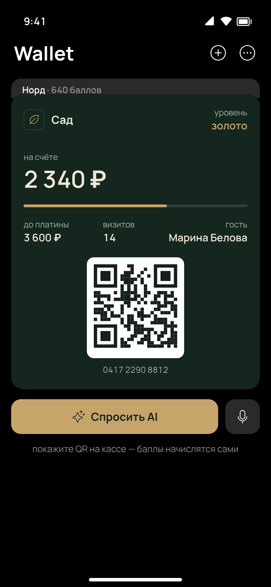 |
| `02-karta-google-wallet` | 390×844 | 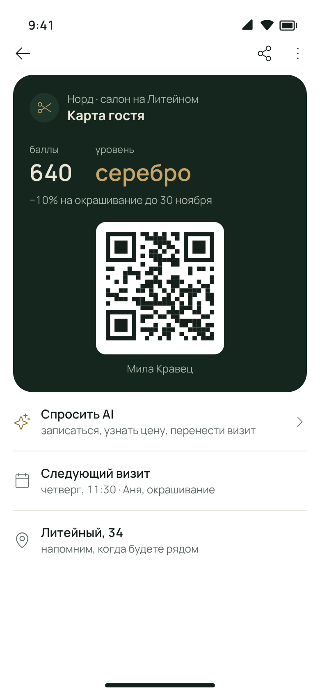 |
| `03-push-ekran-blokirovki` | 390×844 | 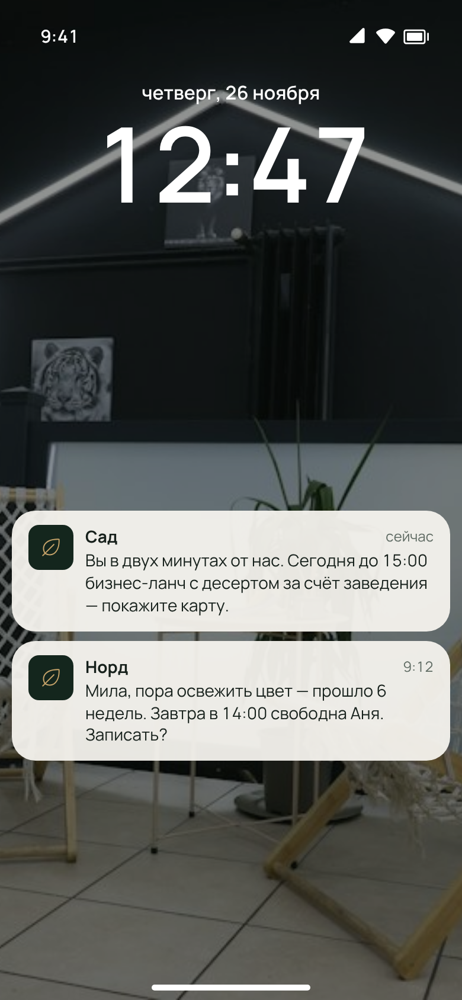 |
| `04-oborot-karty` | 390×844 | 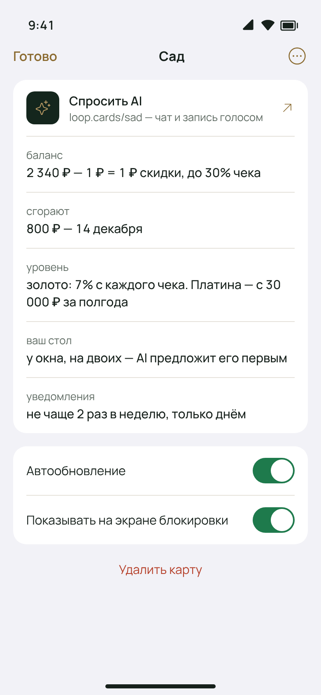 |
| `05-dobavit-po-qr` | 390×844 | 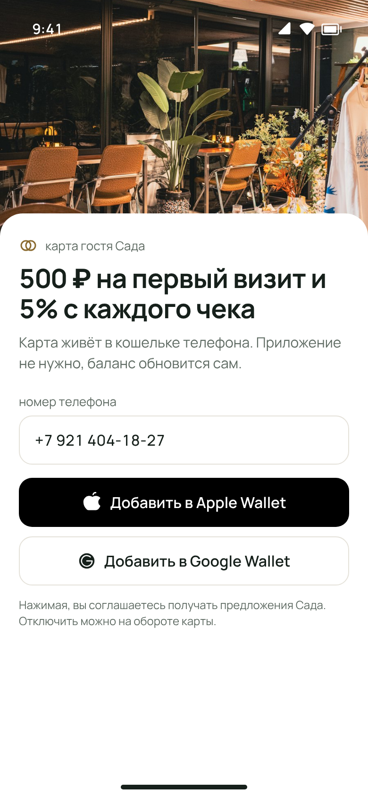 |
| `06-chat-ai` | 390×844 | 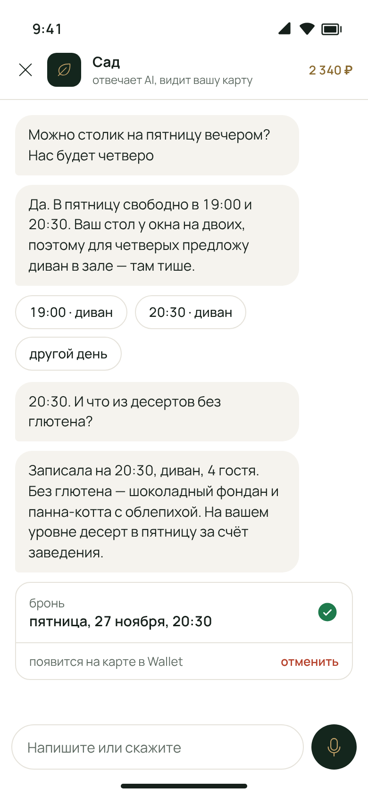 |
| `07-golos-app-clip` | 390×844 | 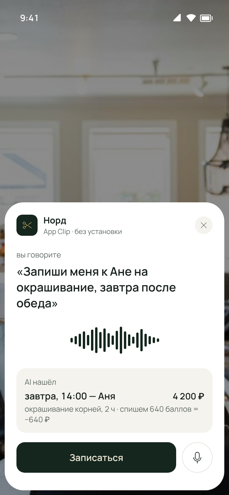 |
| `08-zapis-podtverzhdena` | 390×844 | 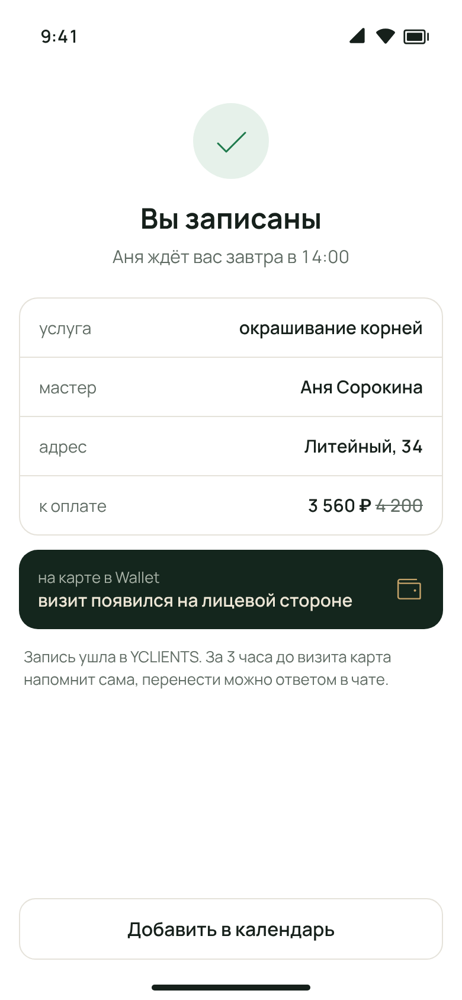 |
| `10-vladelets-svodka` | 390×844 | 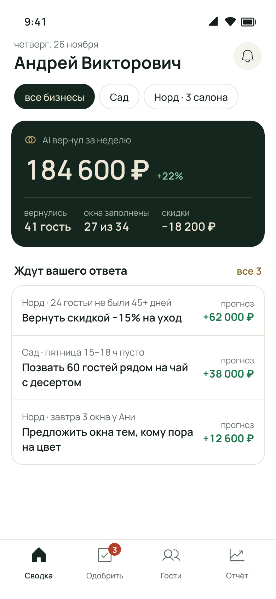 |
| `11-vladelets-odobrit` | 390×844 | 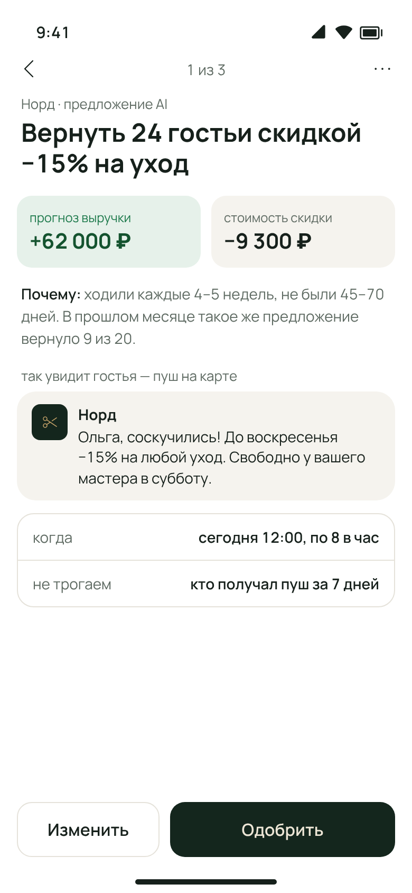 |
| `12-vladelets-otchet` | 390×844 | 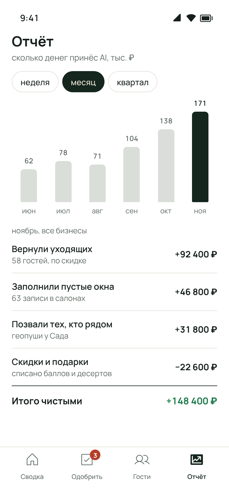 |
| `30-kompyuter-svodka` | 1440×900 | 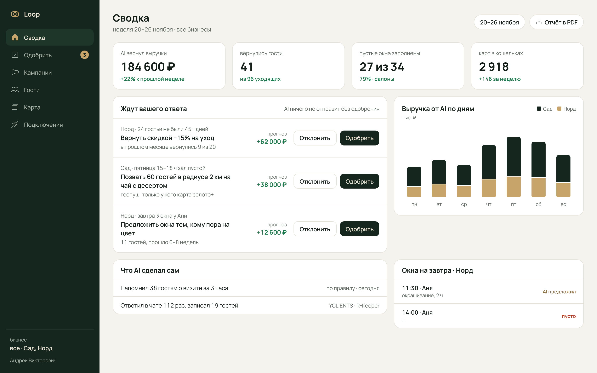 |
| `31-kompyuter-gosti` | 1440×900 | 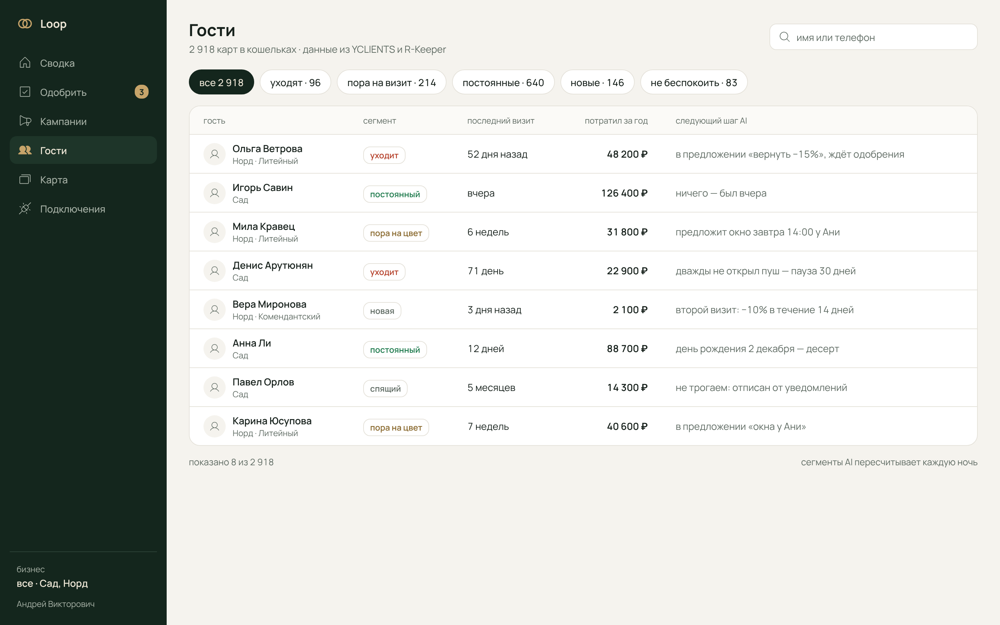 |
| `32-kompyuter-karta-i-podklyucheniya` | 1440×900 | 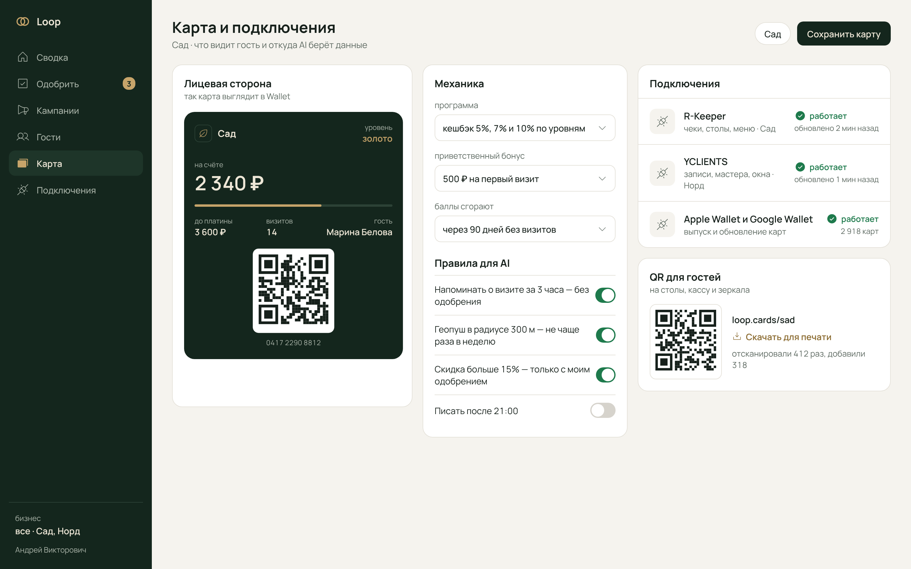 |
