# Owner OS — одно приложение для владельца и руководителей всех бизнесов

Дизайн-комплект для реализации. Папки: `html/` — вёрстка экранов, `screens/` — PNG @2x, `photos/` — фото, `fonts/` — шрифт.

## Токены
Оболочка нейтральная, цвет дают только бизнесы.
| Роль | Цвет |
|---|---|
| Текст, кнопки | #111317 |
| Вторичный текст | #676B72 |
| Линии | #E7E7E4 |
| Фон | #FFFFFF / #F4F4F2 |
| Ресторан («Сад») | #FF7A1A, текст #C24E00 |
| Сеть салонов («Норд») | #2E8C86 / #0E3B43 |
| Деньги под вопросом | #D9452B |
| Рост | #1E7A4C |

Шрифт: **Geologica** 400/500/600/700.

## Роли и механика
Одно приложение, видимость по роли: владелец (все бизнесы, только поднятые вопросы), директор бизнеса (лимит 100 000 ₽), управляющий ресторана (70 000 ₽), управляющая точки (30 000 ₽), финансы (только деньги, чтение). Линейный персонал — в Telegram-боте и рабочих экранах. Вопрос поднимается наверх, если выше лимита роли или не решён 2 дня; цены, скидки выше 10% и найм — всегда к владельцу. Ассистент действует только после подтверждения. Одна цепочка «вопрос → задача → переписка» с общим статусом (экран 10). Лимиты условные.

## Общие правила (для всех трёх продуктов)
- Источник истины — файлы в `html/`: это готовая вёрстка каждого экрана (инлайн-стили). Переносите размеры, отступы, цвета и тексты из них, а `screens/` (PNG @2x) — как эталон для сверки.
- Фото — только из `photos/`. Шрифт — из `fonts/` (или Google Fonts). Иконки — Phosphor Icons (https://phosphoricons.com), вес Light; активный пункт меню — Fill.
- Запрещено (признаки «сделано нейросетью»): тёмные градиентные фоны с размытыми пятнами, стекло (glassmorphism) на каждом блоке, фиолетовый светящийся шар ИИ, ярко-синий iOS как основной цвет, подписи ЗАГЛАВНЫМИ с разрядкой, буквы-аббревиатуры вместо иконок, одинаковые карточки с одной и той же мягкой тенью, эмодзи как иконки.
- Карточки: тонкая линия 1px вместо мягкой тени, скругления 12–22px. Цифры моноширинные (tabular-nums). Подписи с маленькой буквы, без точек-разделителей «A · B · C».
- Фото людей со стоков не ставить рядом с обвинениями (случаи, «нужен разговор»): только интерьеры, руки, стойки.
- Названия в комплекте нейтральные: «Норд» = сеть салонов, «Сад» = ресторан, «Андрей Викторович» = владелец. В приложении используйте названия, которые уже заданы в вашем проекте.
- Все цифры демонстрационные.

## Экраны
Номера: 01–19 телефон 390px, 20–29 планшет 1194×834, 30+ компьютер 1440px.

| Файл | Размер | Вид |
|---|---|---|
| `01-puls-vladelets` | 390×844 | 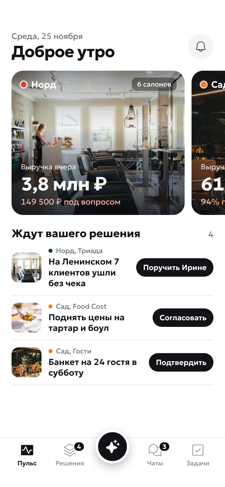 |
| `02-resheniya` | 390×844 | 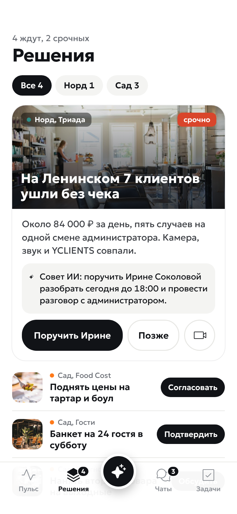 |
| `03-chaty` | 390×844 | 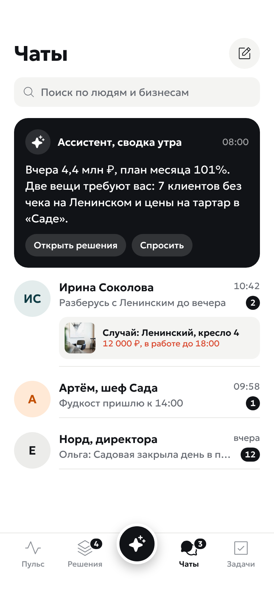 |
| `04-perepiska` | 390×844 | 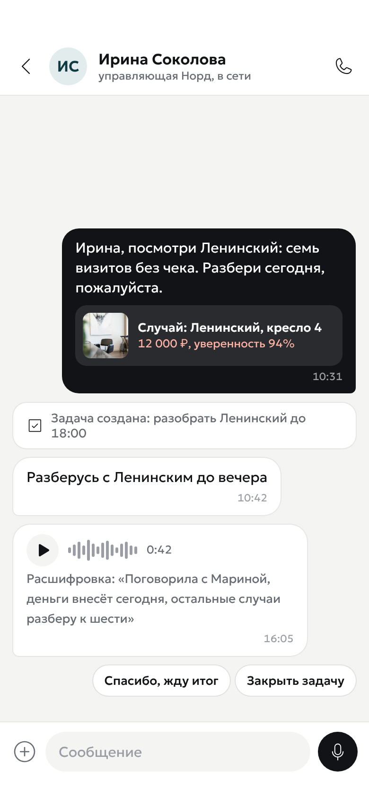 |
| `05-zadachi` | 390×844 | 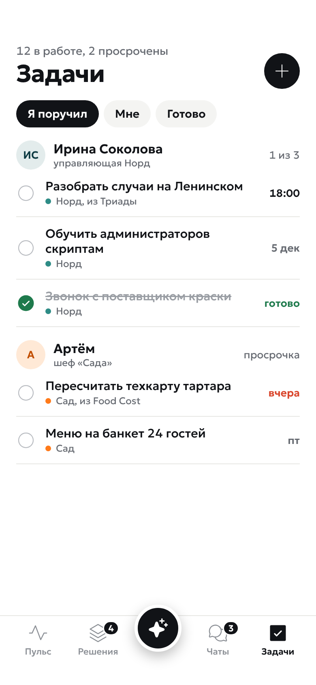 |
| `06-assistent` | 390×844 | 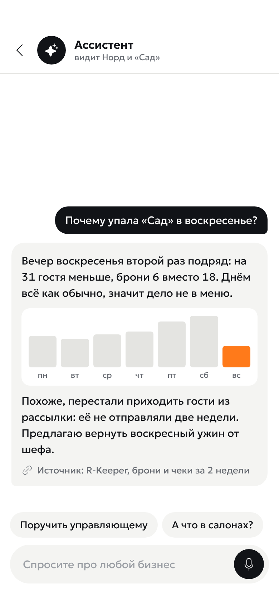 |
| `07-rol-direktor` | 390×844 | 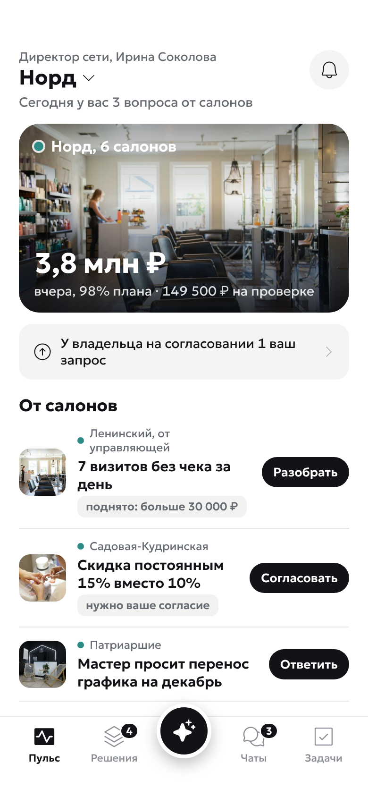 |
| `08-rol-upravlyayuschaya` | 390×844 | 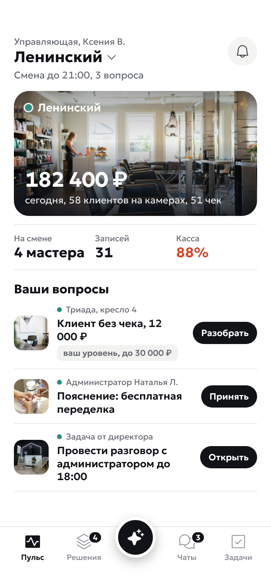 |
| `09-ekran-biznesa` | 390×844 | 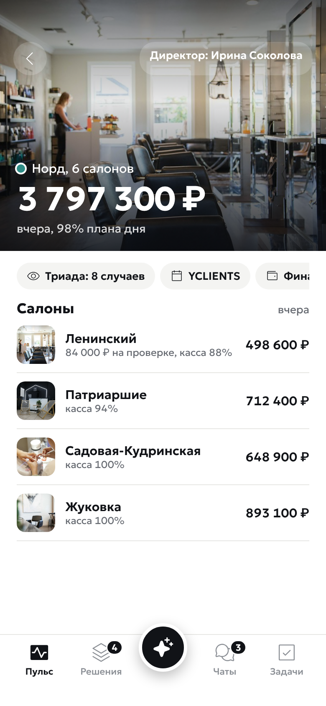 |
| `10-put-voprosa` | 390×844 | 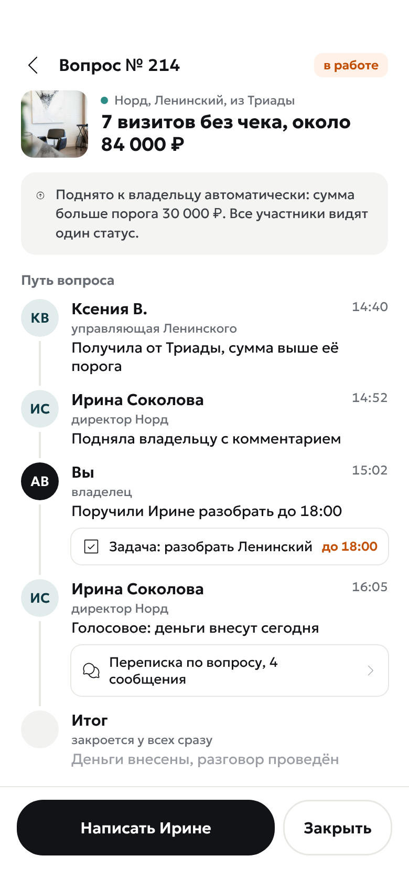 |
| `20-planshet-direktora` | 1194×834 | 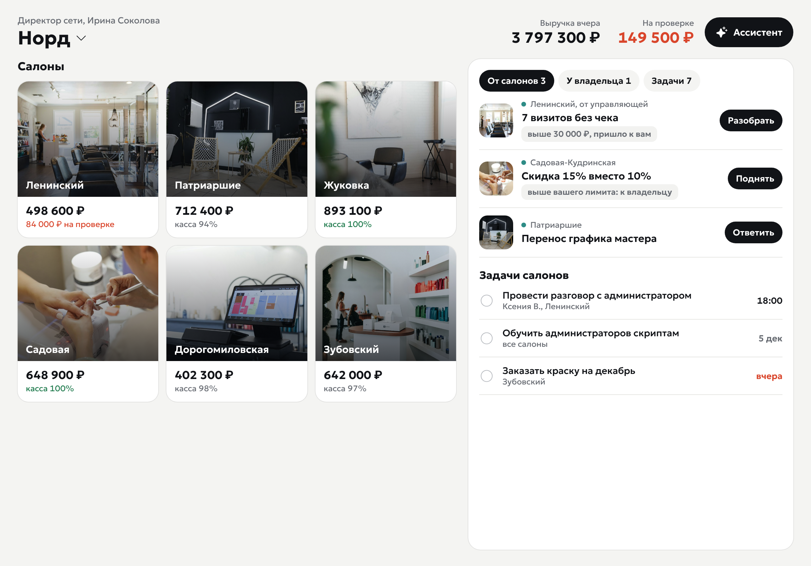 |
| `30-kompyuter-vladeltsa` | 1440×900 | 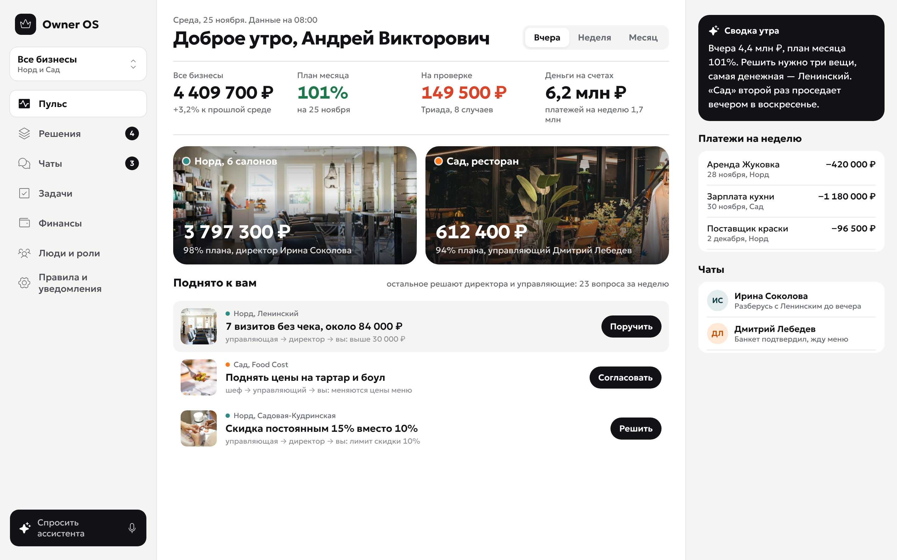 |
| `31-lyudi-roli-pravila` | 1440×900 | 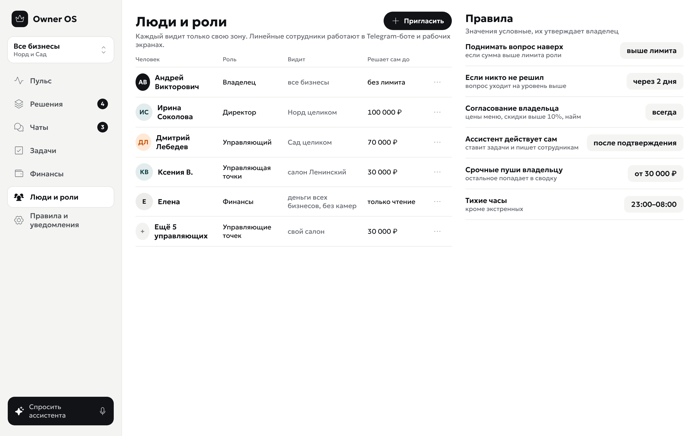 |

## Нижний бар (обновление 26.11.2026, важнее всего выше)
Мобильный нижний бар в стиле Apple (iOS): плавающая капсула над нижним краем с отступами 12–16 px по бокам и от safe area, лёгкое стекло — полупрозрачный фон (~70–75 % непрозрачности цвета поверхности продукта), backdrop-filter: blur(20px) saturate(180%), тонкая светлая обводка 0.5–1 px, мягкая тень. Активная вкладка — заливная иконка Phosphor и мягкая подложка-пилюля цветом акцента продукта; подписи 10–11 px. Контент прокручивается под баром. При prefers-reduced-transparency — сплошной фон. Цвета и шрифт — продукта. Виджет AURA это не затрагивает: он всегда без стекла.
