# Resto AI — конструктор ИИ-модулей для ресторана поверх R-Keeper/iiko

Дизайн-комплект для реализации. Папки: `html/` — вёрстка экранов, `screens/` — PNG @2x, `photos/` — фото, `fonts/` — шрифт.

## Токены
| Роль | Цвет |
|---|---|
| Текст | #1F1A17 |
| Вторичный текст | #6B625B |
| Линии | #ECE9E4 |
| Фон | #FFFFFF / #FAF9F7 |
| Бренд, кнопки, ИИ | #2B1730 (баклажан) |
| Акцент | #FF7A1A (мандарин), текстовый вариант #C24E00 |
| Хорошо | #1F7A4D |

Шрифт: **Onest** 400/500/600/700.

## Механика
Каждый модуль — страница: сверху фото на ~430px с главным выводом, при прокрутке шапка сжимается в тёмную полосу (экран 05). У каждого модуля строка свежести данных из R-Keeper (и состояние «нет связи», экран 06). Нижнее меню: Модули, Входящие, кнопка ИИ по центру, Задачи, Профиль. ИИ знает текущий модуль (экраны 07–08). Роли: управляющий видит 7 модулей, кухня — 3, бар — 3 (экран 10). После действия — уведомление с «Отменить» (11).

## Общие правила (для всех трёх продуктов)
- Источник истины — файлы в `html/`: это готовая вёрстка каждого экрана (инлайн-стили). Переносите размеры, отступы, цвета и тексты из них, а `screens/` (PNG @2x) — как эталон для сверки.
- Фото — только из `photos/`. Шрифт — из `fonts/` (или Google Fonts). Иконки — Phosphor Icons (https://phosphoricons.com), вес Light; активный пункт меню — Fill.
- Запрещено (признаки «сделано нейросетью»): тёмные градиентные фоны с размытыми пятнами, стекло (glassmorphism) на каждом блоке, фиолетовый светящийся шар ИИ, ярко-синий iOS как основной цвет, подписи ЗАГЛАВНЫМИ с разрядкой, буквы-аббревиатуры вместо иконок, одинаковые карточки с одной и той же мягкой тенью, эмодзи как иконки.
- Карточки: тонкая линия 1px вместо мягкой тени, скругления 12–22px. Цифры моноширинные (tabular-nums). Подписи с маленькой буквы, без точек-разделителей «A · B · C».
- Фото людей со стоков не ставить рядом с обвинениями (случаи, «нужен разговор»): только интерьеры, руки, стойки.
- Названия в комплекте нейтральные: «Норд» = сеть салонов, «Сад» = ресторан, «Андрей Викторович» = владелец. В приложении используйте названия, которые уже заданы в вашем проекте.
- Все цифры демонстрационные.

## Экраны
Номера: 01–19 телефон 390px, 20–29 планшет 1194×834, 30+ компьютер 1440px.

| Файл | Размер | Вид |
|---|---|---|
| `01-segodnya` | 390×844 | 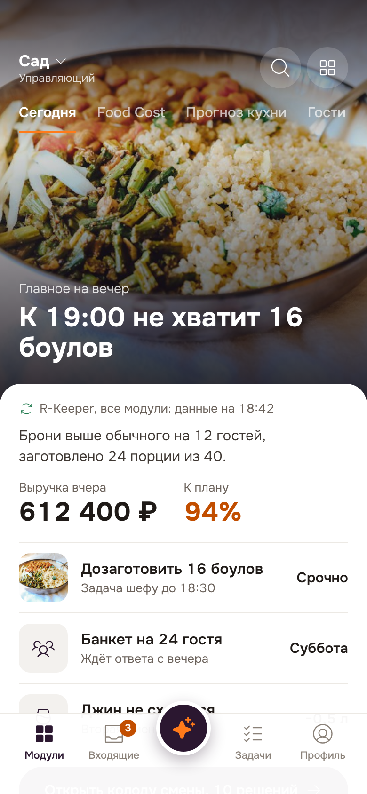 |
| `02-food-cost` | 390×844 | 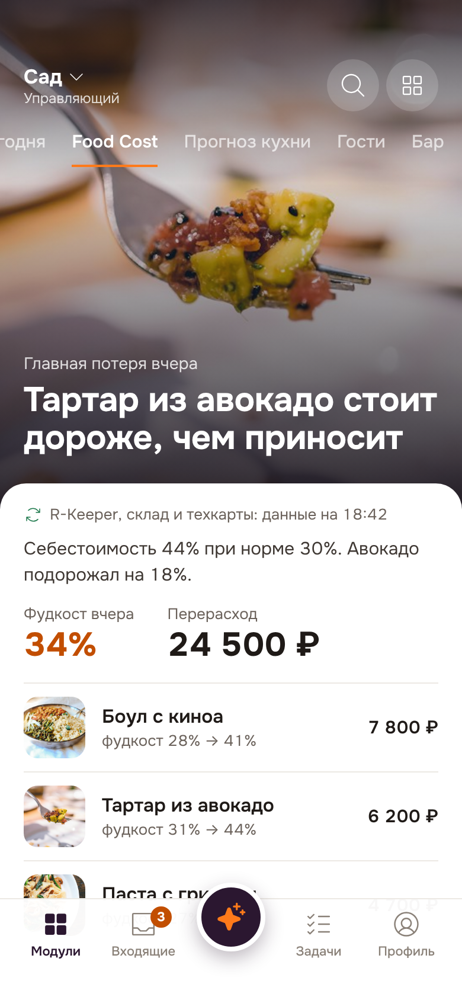 |
| `03-gosti` | 390×844 | 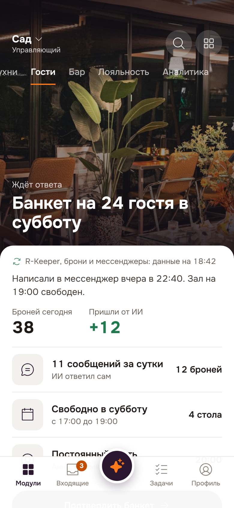 |
| `04-analitika` | 390×844 | 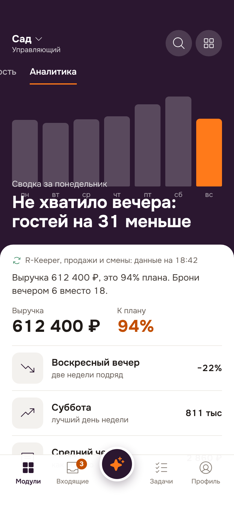 |
| `05-shapka-szhata` | 390×844 | 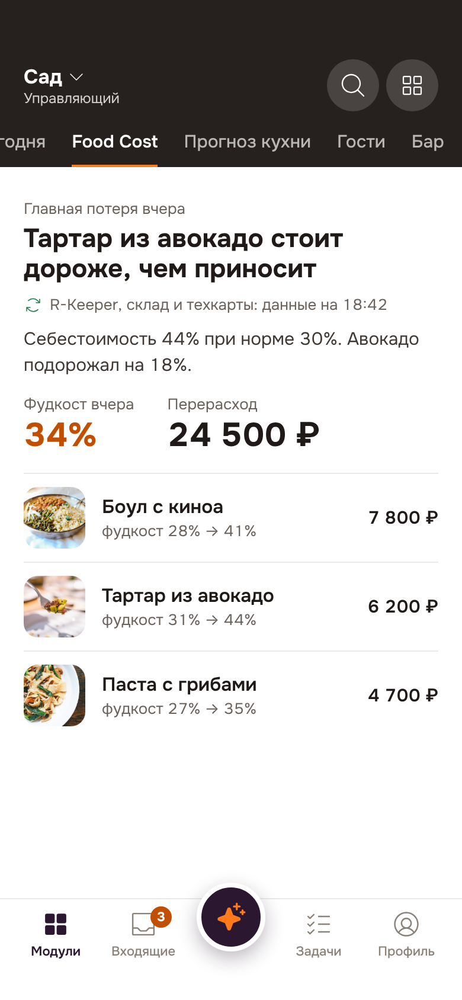 |
| `06-net-svyazi-rkeeper` | 390×844 | 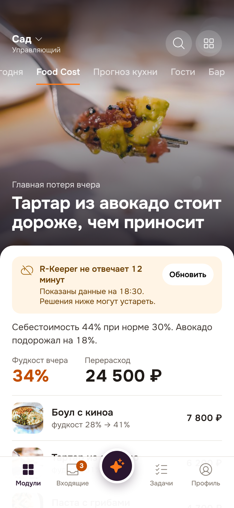 |
| `07-ii-voprosy` | 390×844 | 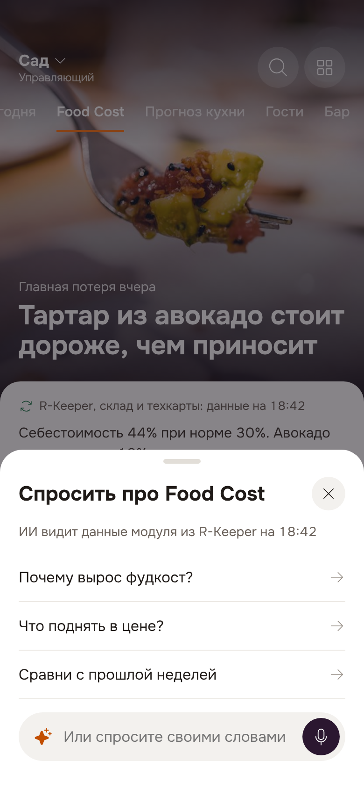 |
| `08-ii-otvet` | 390×844 | 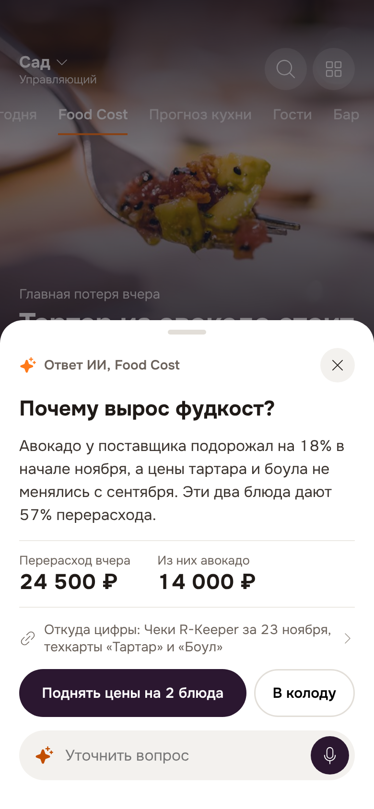 |
| `09-vse-moduli` | 390×844 | 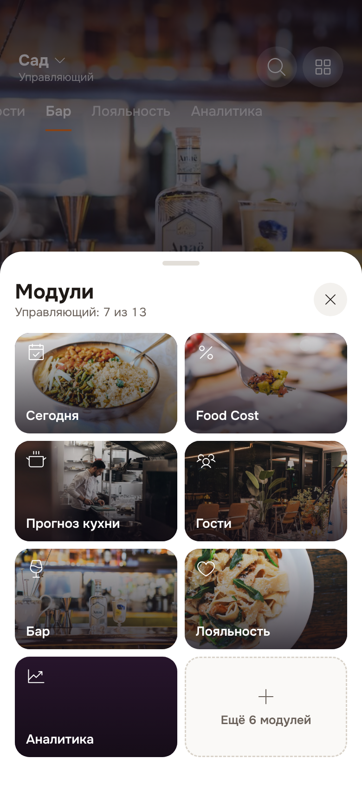 |
| `10-zavedenie-i-rol` | 390×844 | 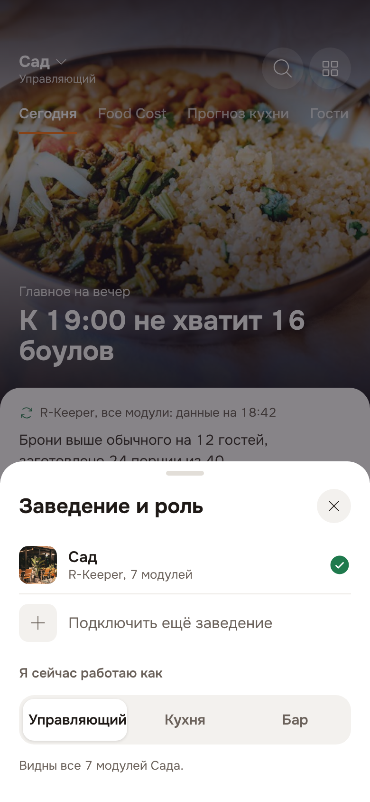 |
| `11-deystvie-otmenit` | 390×844 | 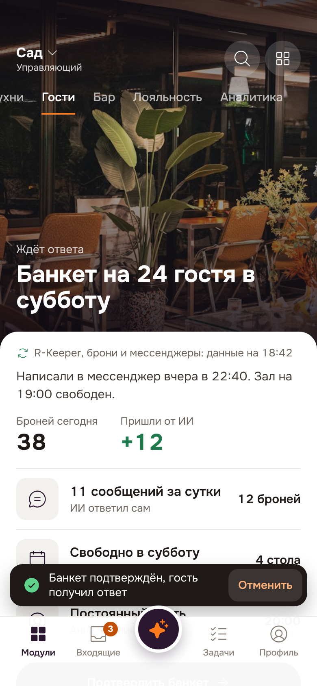 |
| `12-vhodyaschie` | 390×844 | 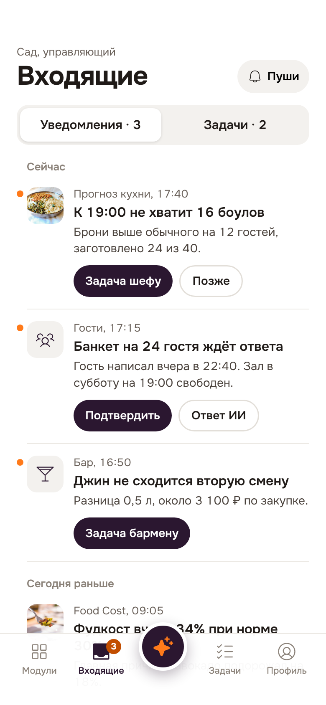 |
| `13-zadachi` | 390×844 | 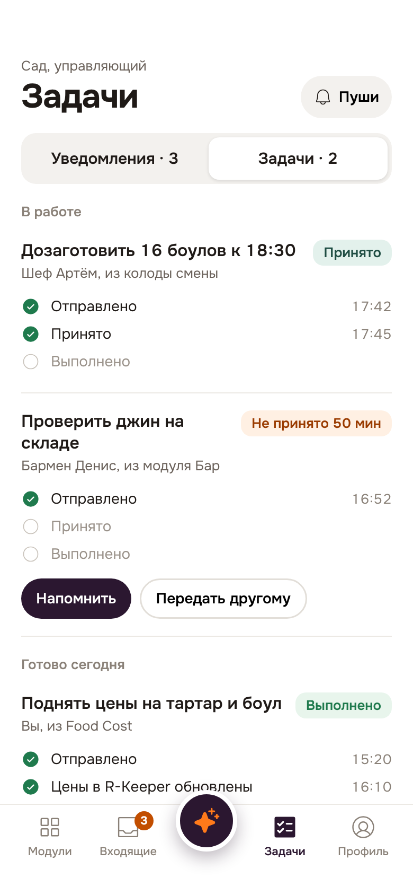 |
| `20-planshet-kuhni` | 1194×834 | 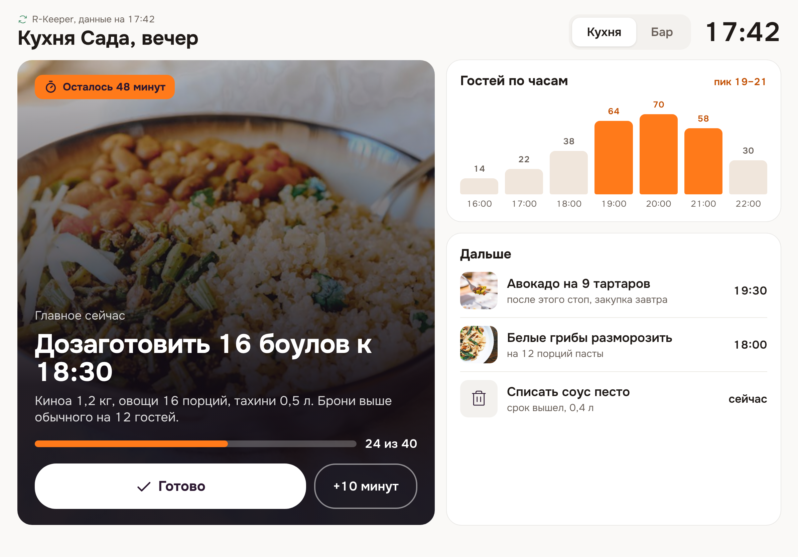 |
| `30-kompyuter-adminka` | 1440×900 | 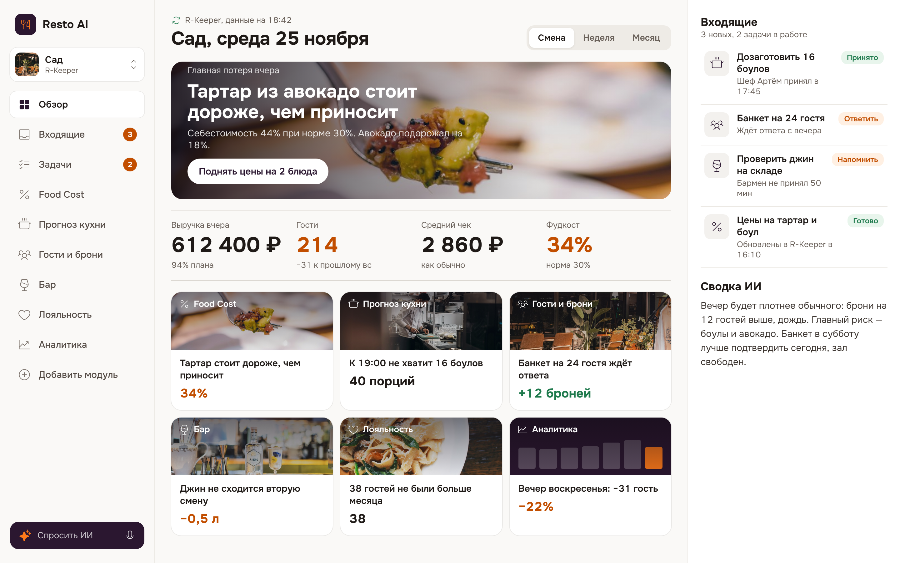 |
