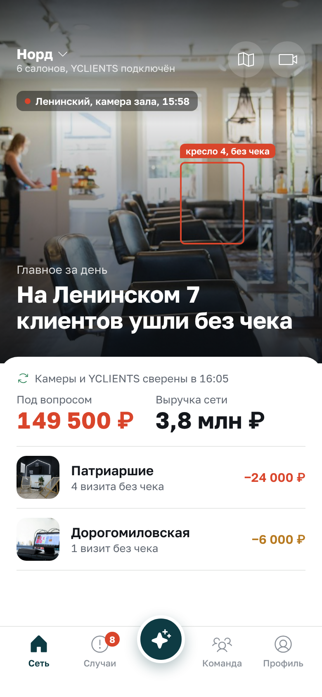
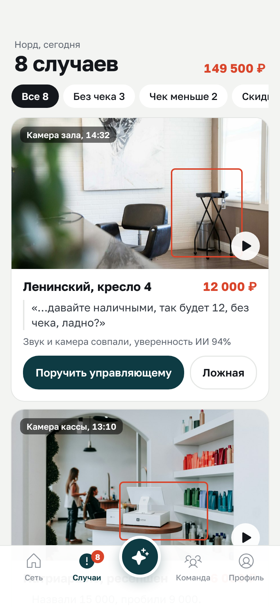
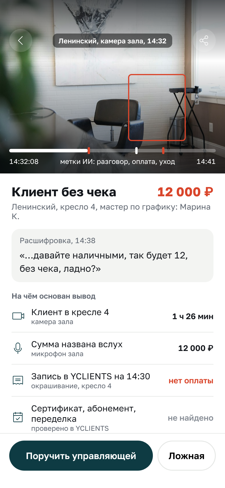
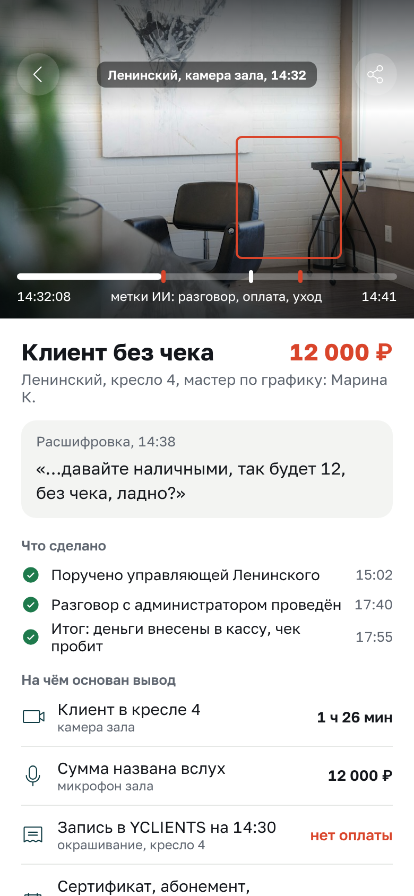
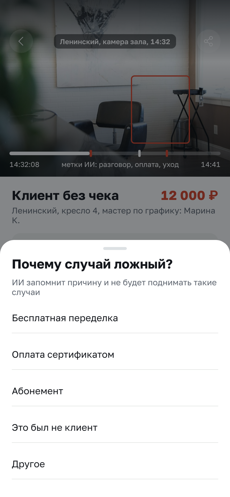
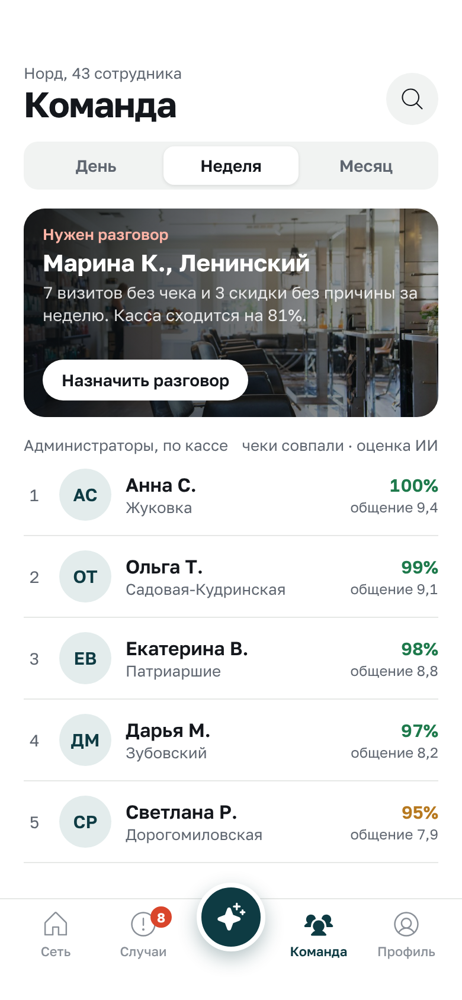
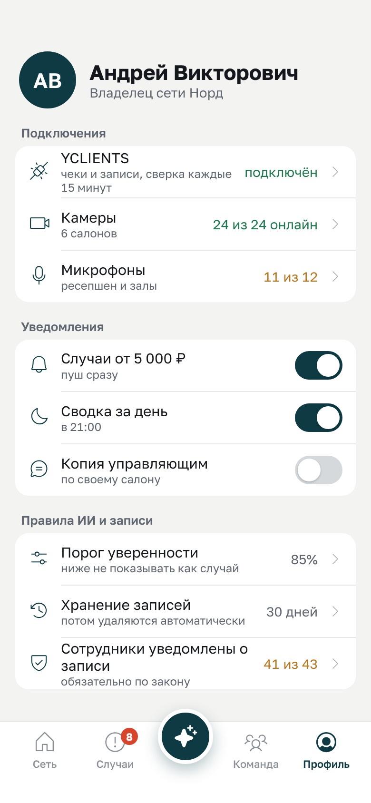
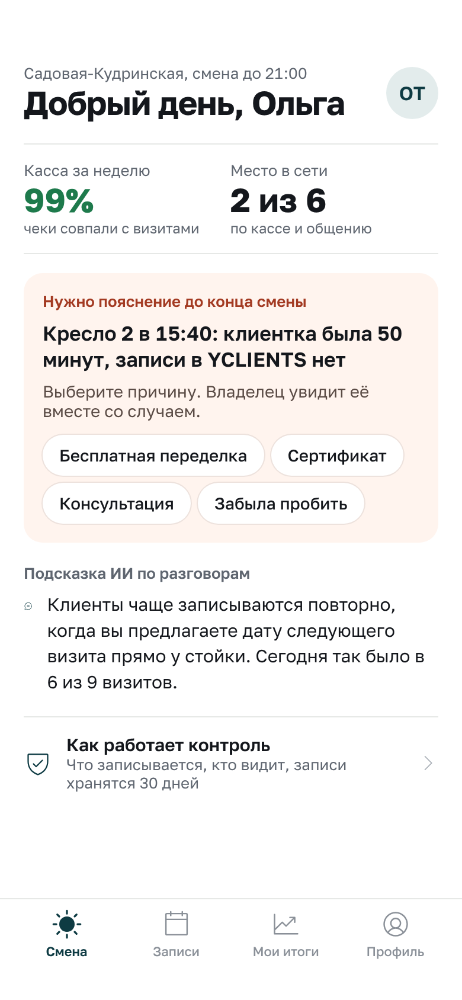
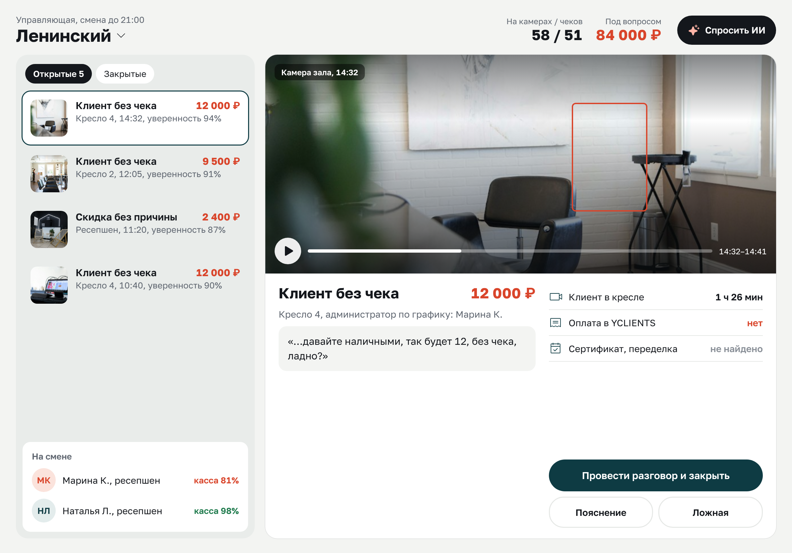
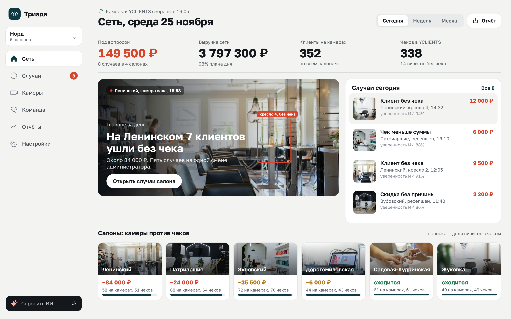

# Триада — ИИ-контроль салонов (камеры с микрофонами + сверка с чеками YCLIENTS)

Дизайн-комплект для реализации. Папки: `html/` — вёрстка экранов, `screens/` — PNG @2x, `photos/` — фото, `fonts/` — шрифт.

## Токены
| Роль | Цвет |
|---|---|
| Текст | #14171C |
| Вторичный текст | #5F6670 |
| Линии | #E6E8E6 |
| Фон страницы | #F3F4F2, поверхности #FFFFFF |
| Основной (кнопки, активное) | #0E3B43 (хвойно-бирюзовый) |
| Деньги под вопросом / «без чека» | #D9452B (коралл) |
| Сходится | #1E7A4C |
| Мелкие отклонения | #B7791F |

Шрифт: **Golos Text** 400/500/600/700.

## Навигация
Телефон: нижнее меню на всю ширину — Сеть, Случаи (бейдж), круглая кнопка ИИ по центру (#0E3B43, иконка sparkle), Команда, Профиль. Планшет: мастер-деталь (список случаев слева, выбранный случай справа). Компьютер: боковое меню слева.

## Общие правила (для всех трёх продуктов)
- Источник истины — файлы в `html/`: это готовая вёрстка каждого экрана (инлайн-стили). Переносите размеры, отступы, цвета и тексты из них, а `screens/` (PNG @2x) — как эталон для сверки.
- Фото — только из `photos/`. Шрифт — из `fonts/` (или Google Fonts). Иконки — Phosphor Icons (https://phosphoricons.com), вес Light; активный пункт меню — Fill.
- Запрещено (признаки «сделано нейросетью»): тёмные градиентные фоны с размытыми пятнами, стекло (glassmorphism) на каждом блоке, фиолетовый светящийся шар ИИ, ярко-синий iOS как основной цвет, подписи ЗАГЛАВНЫМИ с разрядкой, буквы-аббревиатуры вместо иконок, одинаковые карточки с одной и той же мягкой тенью, эмодзи как иконки.
- Карточки: тонкая линия 1px вместо мягкой тени, скругления 12–22px. Цифры моноширинные (tabular-nums). Подписи с маленькой буквы, без точек-разделителей «A · B · C».
- Фото людей со стоков не ставить рядом с обвинениями (случаи, «нужен разговор»): только интерьеры, руки, стойки.
- Названия в комплекте нейтральные: «Норд» = сеть салонов, «Сад» = ресторан, «Андрей Викторович» = владелец. В приложении используйте названия, которые уже заданы в вашем проекте.
- Все цифры демонстрационные.

## Экраны
Номера: 01–19 телефон 390px, 20–29 планшет 1194×834, 30+ компьютер 1440px.

| Файл | Размер | Вид |
|---|---|---|
| `01-set-glavnyy` | 390×844 |  |
| `02-sluchai` | 390×844 |  |
| `03-sluchay` | 390×844 |  |
| `04-sluchay-zakryt` | 390×844 |  |
| `05-lozhnaya-prichina` | 390×844 |  |
| `06-komanda` | 390×844 |  |
| `07-profil` | 390×844 |  |
| `08-ekran-administratora` | 390×844 |  |
| `20-planshet-upravlyayuschey` | 1194×834 |  |
| `30-kompyuter-vladeltsa` | 1440×900 |  |
